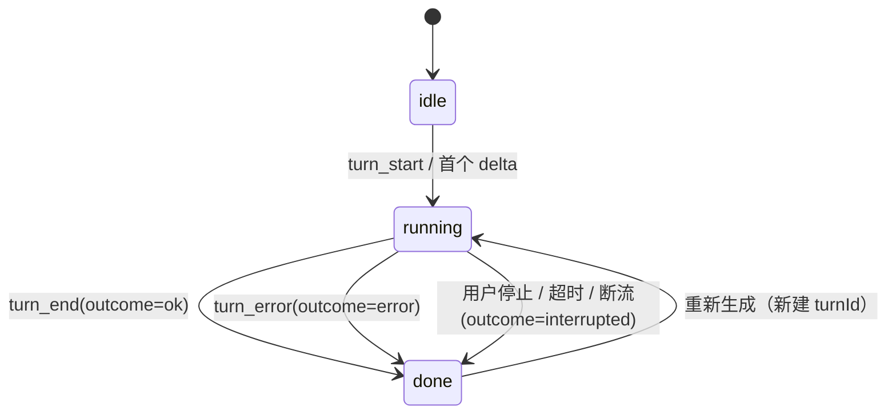

# 知识库问答 Agent 消息气泡交互方案（豆包同款流式体验）

| 字段 | 值 |
| --- | --- |
| 文档版本 | V1.0 |
| 编写日期 | 2026-11-14 |
| 关联任务 | T05740 |
| 适用项目 | Karpathy AI + Obsidian 知识库（`karpathy-wiki`） |
| 技术栈 | Vue 3.4 + TypeScript 5.4 + 原生 CSS（仓库未接入 Tailwind，取舍见 §6.5） |
| 交付形态 | 六章方案 + 可直接落地的组件/CSS/状态机代码（已落地 `frontend/src` 并通过 `vue-tsc` 与单测） |
| 范围 | 前端交互与渲染层；不含模型提示词设计、不含后端 RAG 检索策略 |
| 验证状态 | 编译通过、单测通过；未做真实浏览器 UI 实测（见 §5.6 验证缺口） |

---

## 目录

1. [章节 1：交互 & 状态设计](#章节-1交互--状态设计)
2. [章节 2：数据协议设计（SSE 流式消息体）](#章节-2数据协议设计sse-流式消息体)
3. [章节 3：CSS 动画实现代码](#章节-3css-动画实现代码)
4. [章节 4：Vue 3 + TS 核心组件代码](#章节-4vue-3--ts-核心组件代码)
5. [章节 5：流式解析 & 状态控制逻辑](#章节-5流式解析--状态控制逻辑)
6. [章节 6：接入集成指引](#章节-6接入集成指引)
7. [附录 A：技术取舍点](#附录-a技术取舍点)
8. [附录 B：文件清单与验证记录](#附录-b文件清单与验证记录)
9. [附录 C：配套调整选项](#附录-c配套调整选项)

---

## 章节 1：交互 & 状态设计

### 1.1 设计目标与边界

**目标**：把「思考 → 工具 → 回答」这条 Agent 执行链，用豆包客户端的视觉语言表达出来，让用户在任何时刻都能回答三个问题：

1. Agent 现在在干什么（思考 / 调工具 / 写答案）？
2. 它已经产出了什么（哪些内容已经稳定，哪些还在变）？
3. 这次是否正常结束（完成 / 失败 / 被我中断）？

**边界**：

- 只定义消息气泡的渲染与状态，不定义模型提示词、检索策略、引用打分。
- 流光不是装饰，而是**状态的视觉化**：`running` 是唯一起播条件，`done` 必须淡出。
- 不改变现有 `Query.vue` 的行为：新组件独立可挂载，接入按 §6.2 的分阶段步骤推进。

### 1.2 消息类型枚举

| 枚举值 | 语义 | 数据来源（协议事件） | 默认折叠 | 流光 | 打字机 |
| --- | --- | --- | --- | --- | --- |
| `user` | 用户输入 | 本地创建（非流式） | 不适用 | 无 | 无 |
| `ai_think` | Agent 思考链路 | `think_delta` / `think_end` | `running` 展开，`done` 折叠 | 标题文字流光 + 上沿扫描线 | 无 |
| `ai_tool` | 工具调用状态 | `tool_start` / `tool_progress` / `tool_end` | 始终单行展开，详情区常显 | 状态点脉冲 + 扫描线 | 无 |
| `ai_answer` | 最终回答 | `answer_delta` / `answer_end` | 不可折叠 | 表面横向扫描，`done` 600ms 淡出 | 有（可关） |

**为什么把 `ai_think` / `ai_tool` / `ai_answer` 做成并列的「块」而不是三个独立消息**：

- 一个 Agent 回合可能包含多轮「思考 → 工具 → 思考 → 工具 → 回答」，若强行合并成一条消息，时序会被压平；
- 若做成三条独立消息，用户会看到三个头像/三段间距，视觉上被拆散，且无法共享同一份流状态（`turn.phase`）。
- 因此采用「一个回合（ChatTurnVM）→ 按到达顺序排列的块（blocks）」：既保留时序，又保持一个气泡组。

### 1.3 三态定义与终态结果

任务书要求三态：`idle` / `running` / `done`。三态描述的是**动画阶段**，无法表达「结束了但失败了」，因此额外引入正交字段 `outcome`，而不是把 `error` 塞进状态枚举：

| 字段 | 取值 | 含义 |
| --- | --- | --- |
| `phase` | `idle` | 尚未收到任何内容；用户消息直接跳过该态 |
| | `running` | 正在流式输出；所有流光/脉冲/打字机的唯一起播条件 |
| | `done` | 流已结束；所有动效必须收口 |
| `outcome` | `ok` | 正常完成 |
| | `error` | 收到 `turn_error` 或连接异常；可重试 |
| | `interrupted` | 用户停止、超时、断流；保留已生成内容 |

**为什么不让 `error` 成为第四个状态**：CSS 层只关心「是否还在动」，`running` 与 `done` 已足够驱动动画；错误/中断只影响文案与左边条颜色。把两者分开后，动画代码不会因为新增错误类型而膨胀。

### 1.4 状态流转图与触发时机

#### 1.4.1 回合级状态机



#### 1.4.2 块级状态机

| 块类型 | idle → running | running → done | 失败/中断 |
| --- | --- | --- | --- |
| `think` | 首个 `think_delta` | `think_end`；或 `tool_start`（思考任务已交给工具）；或首个 `answer_delta`（开始写答案） | `turn_end(error/interrupted)` 统一收口 |
| `tool` | `tool_start` | `tool_end(status=done)` | `tool_end(status=error)` 只标记该工具失败，回合可继续；`turn_error` 则整体失败 |
| `answer` | 首个 `answer_delta` | `answer_end` 或 `turn_end` | `turn_end(error/interrupted)` 保留已生成文本 |

**关键时序约定**（已在状态机单测中锁定）：

1. `tool_start` 到达时，所有仍在 `running` 的思考块立即收口——对应豆包「思考完就开始调工具」的观感，不依赖后端补发 `think_end`。
2. `answer_delta` 首次到达时，同样收口所有思考块——避免回答已出现、思考区还在闪的错位。
3. `turn_end` 是无条件兜底：任何仍 `running` 的块一律置 `done`，工具若未返回结果按 `outcome` 置 `done` / `error`，避免「幽灵流光」。

#### 1.4.3 一次典型问答的事件时序

```text
用户发送
  │
  ├─ turn_start(assistant)            → 显示「正在连接知识库…」
  ├─ think_delta × N                  → 思考块流式展开，标题文字流光
  ├─ tool_start(search_pages)         → 思考收口，工具卡出现，状态点脉冲
  ├─ tool_end(done, 3 页, 1.2s)        → 工具卡变「已完成」，显示命中摘要
  ├─ think_delta × M（第二轮可选）     → 新的思考块（不覆盖第一段）
  ├─ tool_start(read_page) ...
  ├─ answer_delta × K                 → 回答气泡出现，表面扫描 + 打字机
  └─ turn_end(ok)                     → 回答块 done：流光 600ms 淡出 → DOM 移除
```

### 1.5 折叠默认配置

| 配置项 | 默认值 | 说明 |
| --- | --- | --- |
| `defaultThinkExpanded` | `false` | 流结束后思考块折叠为「已深度思考 1.2s」摘要 |
| `autoExpandOnRun` | `true` | `running` 时自动展开，让用户看到实时推理；用户一旦手动操作，状态机不再覆盖（`userTouched` 粘性） |
| 工具卡折叠 | 不折叠 | 工具卡本身就是一行摘要；`argsPreview`/错误信息在第二行常显，不再套一层折叠 |
| 回答折叠 | 永不折叠 | 回答是主内容 |
| 思考正文最大高度 | `240px` | 超出内部滚动（`overscroll-behavior: contain`），不把整页顶长 |

### 1.6 视觉规范

#### 1.6.1 配色（全部消费仓库主题 token）

| 元素 | Token | 用途 |
| --- | --- | --- |
| 用户气泡底色 | `--bubble-user-bg` | 渐变底，8 套主题各自定义 |
| 用户气泡前景 | `--bubble-user-fg` + `--bubble-user-text-shadow` | 对比度已达标的配对 token（T04447 教训） |
| AI 回答气泡底 | `--accent-cyan-a06` | 低饱和青，与页面底色可区分 |
| AI 回答描边 | `--accent-readable` | 主题强调色 |
| 思考气泡底 | `--accent-purple-a04`（running `a08`） | 低饱和紫，与回答视觉隔离 |
| 思考左边条 | `--purple-readable` | 弱提示，不抢正文 |
| 工具卡底 | `--accent-cyan-a06`（running `a10`） | 与回答同色系但更薄 |
| 工具左边条 | `--accent-readable` | 与思考的紫色形成类别区分 |
| 错误/中断 | `--danger` / `--warning` | 左侧状态条 + 文案色 |
| 流光主体 | `--accent-cyan-a10` | 低 alpha，不吞正文 |

> 约束：前景/背景必须成对使用 token，不允许在新组件里写死 `#fff` / `#000`；浅色主题（`light-business`、`macaron`）依赖 token 自动回退。

#### 1.6.2 间距、圆角、字号、层级

| 维度 | 规格 |
| --- | --- |
| 消息行间距 | `14px`（`.kw-row` margin） |
| 回合内块间距 | `8px`（`.kw-ai-stack` gap） |
| 气泡内边距 | 回答 `10px 12px`；用户 `8px 12px`；思考/工具 `6px 10px` |
| 圆角 | `14px`；用户右上 `4px`、回答左上 `4px`（不对称指向说话方） |
| 正文字号 | 回答/用户 `13.5px`、行高 `1.55`；思考/工具 `11.5px` |
| 工具名 | `--font-mono`，`11px` |
| 宽度 | 用户 `max-width: 75%`；AI 撑满容器（不横向滚动） |
| 层级 | 思考/工具在上，回答在下；回答是唯一带 `backdrop-filter` 的主气泡 |

#### 1.6.3 动效时长

| 动效 | 时长/曲线 | 备注 |
| --- | --- | --- |
| 气泡入场 | `220ms cubic-bezier(.22,.61,.36,1)` | 位移 6px + 轻微缩放，不弹跳 |
| 流光扫描一轮 | `1.7s`，`cubic-bezier(.45,.05,.55,.95)` | 横向、线性感、无回扫 |
| 上沿细光带 | `2.8s linear` | 与主体错速，避免机械同步 |
| 文字流光 | `2s linear` | 仅思考标题 |
| `done` 流光淡出 | `600ms cubic-bezier(.4,0,.2,1)` | 淡出期间动画 `paused`，保留最后一帧 |
| 折叠高度 | `240ms` + 透明度 `180ms` | `grid-template-rows` 0fr→1fr |
| 打字机 | 90 字/秒；积压 >180 字自动 8 倍追赶 | `done` 后 600ms 内收敛全文 |

### 1.7 与现有实现的对照

| 现状（`Query.vue` / `ThinkingBlock.vue`） | 本方案 |
| --- | --- |
| `.msg-bubble` 由页面 scoped 样式定义，用户/助手共用 | 新组件自带 `kw-` 命名空间样式，可独立挂载 |
| `ThinkingBlock` 渲染 harness 步骤（`ThinkingStep[]`） | `ThinkBlock` 渲染模型思考文本（`<think>` 分流后的内容），两者可共存 |
| `msg-bubble.streaming` 用整体脉冲 `neon-pulse` | 流光改为局部扫描层，running 持续、done 淡出，不整块呼吸 |
| 回答直接 `renderMarkdown(streamingAnswer)`，逐 chunk 全量渲染 | 打字机 + Markdown 10fps 节流双轨 |
| 错误/中断用左边条区分 | 沿用同一视觉语言，新增 `kw-status` 文案与重试入口 |

---

## 章节 2：数据协议设计（SSE 流式消息体）

### 2.1 设计原则

1. **只增不改**：文本只允许增量追加（`answer_delta` / `think_delta`），禁止 `full_text` 全量覆盖；前端据此可以安全地做逐字呈现。
2. **单调序号**：每个 `turnId` 内 `seq` 从 1 单调递增；前端用 `BubbleStreamState` 去重、查空洞。
3. **块级寻址**：`blockId` 标识具体思考/回答块；多轮工具时不会把第二轮思考拼到第一段里。
4. **显式终态**：必须收到 `turn_end` 才算完成；HTTP EOF 不等于 done（断流要走 `interrupted` 分支）。
5. **单行 JSON**：每个 SSE `data:` 只放一行 JSON。现有 `parseSSEEvent` 只取最后一条 `data:` 行，多行 JSON 会被截断——这是对服务端的硬约束。
6. **心跳不计业务**：注释帧 `: ping` 只用于重置看门狗，不产生块。

### 2.2 事件枚举

| 事件名（`event:`） | 关键 data 字段 | 语义 |
| --- | --- | --- |
| `turn_start` | `turnId`、`seq`、`role` | 回合开始；assistant 进入 `running` |
| `think_delta` | `turnId`、`seq`、`text`、`blockId?` | 思考文本增量 |
| `think_end` | `turnId`、`seq`、`durationMs?`、`blockId?` | 思考结束；折叠摘要用 |
| `tool_start` | `call{callId,name,title,status,argsPreview?}` | 工具开始 |
| `tool_progress` | `callId`、`message?` | 工具执行阶段提示（轮询/进度） |
| `tool_end` | `callId`、`status`、`summary?`、`durationMs?`、`errorMessage?` | 工具结束（成功/失败） |
| `answer_delta` | `text`、`blockId?` | 回答文本增量 |
| `answer_end` | `blockId?` | 回答段落结束（可选；`turn_end` 会兜底） |
| `turn_end` | `outcome`、`errorMessage?` | 回合终态（ok/error/interrupted） |
| `turn_error` | `message`、`retryable` | 回合级错误（比 turn_end 更具体的快捷方式） |
| `seq_gap` | `expected`、`received` | 客户端本地生成，不来自网络；仅用于 UI 提示 |

### 2.3 JSON Schema

以下 schema 把「SSE 帧」建模为 `{event, data}`：`event` 是 SSE 的 `event:` 行，`data` 是解析后的 JSON 对象。服务端只需保证 `data` 满足对应分支。

```json
{
  "$schema": "https://json-schema.org/draft/2020-12/schema",
  "$id": "https://karpathy-wiki.local/schemas/chat-bubble-sse.json",
  "title": "ChatBubbleSSEFrame",
  "type": "object",
  "required": ["event", "data"],
  "properties": {
    "event": {
      "enum": [
        "turn_start",
        "think_delta",
        "think_end",
        "tool_start",
        "tool_progress",
        "tool_end",
        "answer_delta",
        "answer_end",
        "turn_end",
        "turn_error"
      ]
    },
    "data": {
      "type": "object",
      "required": ["turnId", "seq"],
      "properties": {
        "turnId": { "type": "string", "minLength": 1 },
        "seq": { "type": "integer", "minimum": 1 },
        "blockId": { "type": "string", "minLength": 1 },
        "text": { "type": "string" },
        "role": { "enum": ["user", "assistant"] },
        "durationMs": { "type": "number", "minimum": 0 },
        "callId": { "type": "string", "minLength": 1 },
        "status": { "enum": ["running", "done", "error"] },
        "summary": { "type": "string" },
        "message": { "type": "string" },
        "errorMessage": { "type": "string" },
        "retryable": { "type": "boolean" },
        "outcome": { "enum": ["ok", "error", "interrupted"] },
        "call": {
          "type": "object",
          "required": ["callId", "name", "title"],
          "properties": {
            "callId": { "type": "string", "minLength": 1 },
            "name": { "type": "string", "minLength": 1 },
            "title": { "type": "string", "minLength": 1 },
            "argsPreview": { "type": "string" },
            "status": { "enum": ["running", "done", "error"] },
            "summary": { "type": "string" },
            "durationMs": { "type": "number", "minimum": 0 },
            "progressMessage": { "type": "string" },
            "errorMessage": { "type": "string" }
          }
        }
      }
    }
  },
  "allOf": [
    {
      "if": { "properties": { "event": { "const": "turn_start" } } },
      "then": { "properties": { "data": { "required": ["role"] } } }
    },
    {
      "if": { "properties": { "event": { "const": "think_delta" } } },
      "then": { "properties": { "data": { "required": ["text"] } } }
    },
    {
      "if": { "properties": { "event": { "const": "tool_start" } } },
      "then": { "properties": { "data": { "required": ["call"] } } }
    },
    {
      "if": { "properties": { "event": { "const": "tool_end" } } },
      "then": {
        "properties": {
          "data": { "required": ["status"], "properties": { "status": { "enum": ["done", "error"] } } }
        }
      }
    },
    {
      "if": { "properties": { "event": { "const": "answer_delta" } } },
      "then": { "properties": { "data": { "required": ["text"] } } }
    },
    {
      "if": { "properties": { "event": { "const": "turn_end" } } },
      "then": { "properties": { "data": { "required": ["outcome"] } } }
    },
    {
      "if": { "properties": { "event": { "const": "turn_error" } } },
      "then": { "properties": { "data": { "required": ["message"] } } }
    },
    {
      "if": { "properties": { "event": { "const": "tool_progress" } } },
      "then": { "properties": { "data": { "required": ["callId"] } } }
    }
  ]
}
```

### 2.4 原始 SSE 帧示例

```text
event: turn_start
data: {"turnId":"t-9f3","seq":1,"role":"assistant"}

event: think_delta
data: {"turnId":"t-9f3","seq":2,"blockId":"t-9f3:think:1","text":"先确认知识库里有没有"}

event: tool_start
data: {"turnId":"t-9f3","seq":3,"call":{"callId":"c-1","name":"search_pages","title":"在知识库中检索相关页面","status":"running"}}

event: tool_end
data: {"turnId":"t-9f3","seq":4,"callId":"c-1","status":"done","summary":"命中 3 页","durationMs":1180}

event: answer_delta
data: {"turnId":"t-9f3","seq":5,"blockId":"t-9f3:answer:1","text":"知识库里有三篇"}

event: turn_end
data: {"turnId":"t-9f3","seq":6,"outcome":"ok"}
```

### 2.5 与现有 SSE 协议的兼容适配

现有后端（`api/src/routes/query.ts`、`api/src/workflows/query-workflow.ts`）已经在发 `answer / thinking / progress / refs / followups / multimodal / image / ppt / done / open / clarify / error`。**不必推倒重来**：在前端加一层 `legacy → v2` 适配器，即可让旧服务端驱动新气泡。

| 现有事件 | 现有 payload | 映射到 v2 |
| --- | --- | --- |
| `open` | `runId` | 不产生块；记录可续传 `runId` |
| `thinking` | `phase`、`message`、`tool`、`args`、`ts` | `phase === 'tool_call'` → `tool_start`（`callId` 由 `seq` 合成）；否则 → `think_delta`（`message` 作为一行思考） |
| `progress` | `step`、`count` | 不产生块；可映射为 `turn_start` 占位或工具 `progressMessage` |
| `answer` | `text` | 先喂 `utils/think-parser.ts`：`thinking` 部分 → `think_delta`，`answer` 部分 → `answer_delta` |
| `done` | `sessionId`、`threadId`、`runId`、`governor` | `answer_end` + `turn_end(ok)` |
| `error` | `message` | `turn_error(message, retryable=true)` |
| `clarify` | 澄清卡片字段 | `turn_end(interrupted)` + 现有 `ClarifyCard`（澄清不是气泡正文） |
| `refs` / `followups` / `multimodal` / `image` / `ppt` | 各自结构 | 不进气泡块，保持现有卡片/列表渲染 |

适配器示意（复用现有 `<think>` 分流器，避免二套解析规则）：

```ts
// 与 utils/think-parser.ts 配套使用；每个 turn 一个 parser 实例
import { createThinkStreamParser } from '../utils/think-parser';

function adaptLegacyAnswer(text: string, ctx: LegacyCtx): BubbleStreamEvent[] {
  const { thinking, answer } = ctx.parser.feed(text);
  const events: BubbleStreamEvent[] = [];
  if (thinking) {
    events.push({ type: 'think_delta', turnId: ctx.turnId, seq: ctx.nextSeq(), text: thinking });
  }
  if (answer) {
    events.push({ type: 'answer_delta', turnId: ctx.turnId, seq: ctx.nextSeq(), text: answer });
  }
  return events;
}
```

> 迁移策略：先让适配器跑在旧事件上（P1），验证气泡观感；后端改造（P2）只需把 `send('answer', {text})` 换成 `send('answer_delta', {turnId, seq, text})`，前端无需二次改版。

### 2.6 分片与背压约束

| 约束 | 值 | 原因 |
| --- | --- | --- |
| 单帧 `data` 大小 | ≤ 8 KB | 避免单帧 JSON 解析占用主线程过久 |
| 发送节奏 | 建议 ≤ 50ms/帧，或按 token 批量 8–32 个 | 过碎会导致 Vue 更新过于频繁；过粗会失去流式感 |
| 心跳 | 每 15s 一条 `: ping` | 让前端 20s 空闲看门狗有依据 |
| 序号 | 每 turn 从 1 开始，连续 | 支持去重、空洞检测、断点续传（`afterSeq`） |
| 重放 | `resume` 从 `lastSeq+1` 开始 | 避免重复追加；重复帧由 `seq` 丢弃 |

---

## 章节 3：CSS 动画实现代码

> 完整样式文件：`frontend/src/styles/message-bubble.css`（由 `MessageBubble.vue` 直接 `import`，仅在该组件被使用时加载）。以下为该文件的完整内容。

```css
/* 消息气泡交互样式 —— 豆包同款流式观感（T05740）
 *
 * 命名空间 kw-：
 *   Query.vue / FloatingChat.vue 现有 .msg-bubble 是 scoped 样式，新组件若复用同名类，
 *   在未改造旧页面时可依赖关系会变得隐晦；统一前缀让「新组件自带样式、旧页面零影响」。
 *
 * 颜色全部消费仓库主题 token（NFR-2 配对硬规则），不写死前景/背景；
 * 深浅主题、8 套 data-theme 自动适配，避免出现 T04447 那类「白字压浅色渐变」的对比度事故。
 */

.kw-msg {
  /* 流光主体色：低饱和青，running 时只提亮表面、不吞正文 */
  --kw-shimmer-color: var(--accent-cyan-a10, rgba(0, 245, 255, 0.1));
  --kw-shimmer-fade-ms: 600ms;
  --kw-ease-out: cubic-bezier(0.22, 0.61, 0.36, 1);
}

/* ---------- 行布局 ---------- */

.kw-row {
  display: flex;
  align-items: flex-start;
  gap: 10px;
  margin: 14px 0;
  animation: kw-bubble-in 220ms var(--kw-ease-out) both;
}

.kw-row--user {
  justify-content: flex-end;
}

.kw-row--assistant {
  justify-content: flex-start;
}

.kw-ai-stack {
  display: flex;
  flex-direction: column;
  gap: 8px;
  width: 100%;
  min-width: 0;
}

.kw-avatar {
  flex: 0 0 auto;
  width: 30px;
  height: 30px;
  border-radius: 50%;
  display: flex;
  align-items: center;
  justify-content: center;
  background: var(--on-fire-bg, var(--bubble-user-bg));
  color: var(--on-fire-fg, var(--bubble-user-fg));
  text-shadow: var(--bubble-user-text-shadow);
  font-family: var(--font-mono, ui-monospace, monospace);
  font-size: 10px;
  font-weight: 700;
  box-shadow: var(--glow-magenta, 0 0 12px rgba(255, 0, 110, 0.4));
}

/* ---------- 用户气泡 ---------- */

.kw-bubble--user {
  position: relative;
  max-width: 75%;
  padding: 8px 12px;
  border-radius: 14px;
  border-top-right-radius: 4px;
  background: var(--bubble-user-bg);
  color: var(--bubble-user-fg);
  text-shadow: var(--bubble-user-text-shadow);
  font-size: 13.5px;
  line-height: 1.55;
  overflow-wrap: anywhere;
  box-shadow: 0 4px 20px var(--accent-pink-a30, rgba(255, 0, 110, 0.3));
}

/* 用户气泡内的 Markdown 前景必须跟随气泡 token（MarkdownRenderer 自带 color: --text-base）
   提高前缀到 .kw-msg，避免与 MarkdownRenderer 的 scoped 选择器特异性打平后被源码顺序影响 */
.kw-msg .kw-bubble--user .md-body,
.kw-msg .kw-bubble--user .md-body p,
.kw-msg .kw-bubble--user .md-body li,
.kw-msg .kw-bubble--user .md-body strong,
.kw-msg .kw-bubble--user .md-body em {
  color: var(--bubble-user-fg);
  text-shadow: var(--bubble-user-text-shadow);
}

.kw-msg .kw-bubble--user .md-body a {
  color: var(--bubble-user-fg);
  text-decoration: underline;
}

/* ---------- 思考气泡（低饱和底色，与回答气泡隔离） ---------- */

.kw-think {
  position: relative;
  padding: 6px 10px;
  background: var(--accent-purple-a04, rgba(176, 38, 255, 0.04));
  border-left: 2px solid var(--purple-readable, var(--neon-purple, #b226ff));
  border-radius: 0 8px 8px 0;
  overflow: hidden;
  transition: background-color 240ms var(--kw-ease-out);
}

.kw-think.is-running {
  background: var(--accent-purple-a08, rgba(176, 38, 255, 0.08));
}

.kw-think__head {
  display: flex;
  align-items: center;
  gap: 6px;
  width: 100%;
  padding: 0;
  border: 0;
  background: none;
  color: var(--text-dim, #8b949e);
  font-size: 11.5px;
  line-height: 1.6;
  text-align: left;
  cursor: pointer;
  user-select: none;
}

.kw-think__head:hover .kw-think__title {
  color: var(--text-soft, #9aa4b2);
}

.kw-think__icon {
  flex: 0 0 auto;
  width: 6px;
  height: 6px;
  border-radius: 50%;
  background: var(--purple-readable, #c258ff);
}

.kw-think.is-running .kw-think__icon {
  animation: kw-dot-pulse 1.4s ease-in-out infinite;
}

.kw-think__title {
  flex: 1 1 auto;
  min-width: 0;
  white-space: nowrap;
  overflow: hidden;
  text-overflow: ellipsis;
}

.kw-think__meta {
  flex: 0 0 auto;
  color: var(--text-dim, #8b949e);
  font-size: 10px;
  font-family: var(--font-mono, ui-monospace, monospace);
}

.kw-think__chevron {
  flex: 0 0 auto;
  display: inline-block;
  width: 14px;
  text-align: center;
  color: var(--text-dim, #8b949e);
  transform: rotate(0deg);
  transition: transform 200ms var(--kw-ease-out);
}

.kw-think__chevron.is-open {
  transform: rotate(90deg);
}

/* 折叠高度过渡：grid-template-rows 0fr → 1fr，适配任意内容高度（优于 max-height 的固定上限） */
.kw-collapse {
  display: grid;
  grid-template-rows: 0fr;
  opacity: 0;
  margin-top: 0;
  transition:
    grid-template-rows 240ms var(--kw-ease-out),
    opacity 180ms var(--kw-ease-out),
    margin-top 240ms var(--kw-ease-out);
}

.kw-collapse.is-open {
  grid-template-rows: 1fr;
  opacity: 1;
  margin-top: 6px;
}

.kw-collapse__inner {
  min-height: 0;
  overflow: hidden;
}

/* 不支持 0fr 网格动画的旧内核（Electron 低版本）降级为 max-height */
@supports not (grid-template-rows: 0fr) {
  .kw-collapse {
    display: block;
    max-height: 0;
    overflow: hidden;
  }
  .kw-collapse.is-open {
    max-height: 260px;
  }
}

.kw-think__body {
  max-height: 240px;
  overflow-y: auto;
  overscroll-behavior: contain;
  padding-right: 2px;
}

.kw-think__line {
  margin: 0;
  font-size: 11.5px;
  line-height: 1.7;
  color: var(--text-soft, #9aa4b2);
  white-space: pre-wrap;
  overflow-wrap: anywhere;
}

.kw-think__line + .kw-think__line {
  margin-top: 4px;
}

/* 思考态扫描线：running 时沿气泡上沿往复，done 后随容器重渲染自然移除 */
.kw-think__scan {
  position: absolute;
  top: 0;
  left: 0;
  width: 36%;
  height: 1px;
  pointer-events: none;
  background: linear-gradient(90deg, transparent, var(--purple-readable, #c258ff), transparent);
  animation: kw-edge-sweep 2.4s linear infinite;
}

/* ---------- 工具调用气泡 ---------- */

.kw-tool {
  position: relative;
  padding: 6px 10px;
  background: var(--accent-cyan-a06, rgba(0, 245, 255, 0.06));
  border-left: 2px solid var(--accent-readable, #4d8dff);
  border-radius: 0 8px 8px 0;
  font-size: 11.5px;
  overflow: hidden;
}

.kw-tool.is-running {
  background: var(--accent-cyan-a10, rgba(0, 245, 255, 0.1));
}

.kw-tool.is-error {
  border-left-color: var(--danger, #f85149);
}

.kw-tool__row {
  display: flex;
  align-items: center;
  gap: 6px;
  min-width: 0;
}

.kw-tool__dot {
  flex: 0 0 auto;
  width: 6px;
  height: 6px;
  border-radius: 50%;
  background: var(--accent-readable, #4d8dff);
}

.kw-tool.is-running .kw-tool__dot {
  animation: kw-dot-pulse 1.2s ease-in-out infinite;
}

.kw-tool.is-error .kw-tool__dot {
  background: var(--danger, #f85149);
}

.kw-tool__name {
  flex: 0 0 auto;
  color: var(--accent-readable, #4d8dff);
  font-family: var(--font-mono, ui-monospace, monospace);
  font-size: 11px;
}

.kw-tool__title {
  flex: 1 1 auto;
  min-width: 0;
  color: var(--text-soft, #9aa4b2);
  white-space: nowrap;
  overflow: hidden;
  text-overflow: ellipsis;
}

.kw-tool__meta {
  flex: 0 0 auto;
  color: var(--text-dim, #8b949e);
  font-family: var(--font-mono, ui-monospace, monospace);
  font-size: 10px;
}

.kw-tool__detail {
  margin-top: 4px;
  color: var(--text-dim, #8b949e);
  font-size: 10.5px;
  line-height: 1.6;
  overflow-wrap: anywhere;
}

.kw-tool__error {
  margin-top: 4px;
  color: var(--danger, #f85149);
  font-size: 10.5px;
  line-height: 1.5;
  overflow-wrap: anywhere;
}

/* ---------- 首帧占位：turn_start 已到、内容尚未开始的极短窗口 ---------- */

.kw-pending {
  display: flex;
  align-items: center;
  gap: 6px;
  padding: 7px 10px;
  background: var(--accent-cyan-a06, rgba(0, 245, 255, 0.06));
  border-left: 2px solid var(--accent-readable, #4d8dff);
  border-radius: 0 8px 8px 0;
  font-size: 11.5px;
  color: var(--text-soft, #9aa4b2);
}

.kw-pending__dot {
  width: 6px;
  height: 6px;
  border-radius: 50%;
  background: var(--accent-readable, #4d8dff);
  animation: kw-dot-pulse 1.2s ease-in-out infinite;
}

/* ---------- 回答气泡（主气泡） ---------- */

.kw-answer {
  position: relative;
  isolation: isolate;
  padding: 10px 12px;
  border-radius: 14px;
  border-top-left-radius: 4px;
  border: 1px solid var(--accent-readable, #4d8dff);
  background: var(--accent-cyan-a06, rgba(0, 245, 255, 0.06));
  color: var(--text-base, #c9d1d9);
  font-size: 13.5px;
  line-height: 1.55;
  backdrop-filter: var(--blur, blur(16px));
}

.kw-answer.is-running {
  box-shadow: 0 0 0 1px var(--accent-cyan-a10, rgba(0, 245, 255, 0.1));
}

/* 流结束后状态色左边条：与 Query.vue 现有 interrupted/error 视觉语言一致 */
.kw-answer.is-interrupted {
  border-left: 3px solid var(--warning, #d29922);
}

.kw-answer.is-error {
  border-left: 3px solid var(--danger, #f85149);
}

/* ---------- 流光扫描（核心动效） ---------- */

/* 为什么用「绝对定位覆盖层 + 子元素 transform」而不是动 background-position：
 *   background-position 每帧触发重绘（大面积渐变尤其昂贵），transform 走合成层；
 *   长回答滚动时前者会和滚动合成互相拖累，后者稳定 60fps。 */
.kw-shimmer {
  position: absolute;
  inset: 0;
  z-index: 2;
  border-radius: inherit;
  overflow: hidden;
  pointer-events: none;
  opacity: 0;
  transition: opacity 160ms ease-out;
}

.kw-shimmer.is-running {
  opacity: 1;
}

/* done 之后不是移除节点，而是把覆盖层整体淡出（600ms）；
 * 期间动画暂停（paused）保留最后一帧光带，随透明度一起消失，避免「闪一下没了」。 */
.kw-shimmer.is-fading {
  opacity: 0;
  transition: opacity var(--kw-shimmer-fade-ms, 600ms) cubic-bezier(0.4, 0, 0.2, 1);
}

.kw-shimmer.is-fading .kw-shimmer__band,
.kw-shimmer.is-fading .kw-shimmer__edge {
  animation-play-state: paused;
}

.kw-shimmer__band {
  position: absolute;
  top: -30%;
  bottom: -30%;
  left: 0;
  width: 44%;
  background: linear-gradient(
    100deg,
    transparent 0%,
    var(--kw-shimmer-color, rgba(0, 245, 255, 0.1)) 48%,
    transparent 100%
  );
  transform: translate3d(-160%, 0, 0) skewX(-14deg);
  animation: kw-shimmer-sweep 1.7s cubic-bezier(0.45, 0.05, 0.55, 0.95) infinite;
  will-change: transform;
}

/* 上沿细光带：强化「扫描」方向感，alpha 更低，不盖正文 */
.kw-shimmer__edge {
  position: absolute;
  top: 0;
  left: 0;
  width: 38%;
  height: 1px;
  background: linear-gradient(90deg, transparent, var(--tk-accent, #4d8dff), transparent);
  transform: translateX(-100%);
  animation: kw-edge-sweep 2.8s linear infinite;
  will-change: transform;
}

/* 思考标题的文字流光（仅 running） */
.kw-text-shimmer {
  background: linear-gradient(
    90deg,
    var(--text-dim, #8b949e) 0%,
    var(--purple-readable, #c258ff) 45%,
    var(--text-dim, #8b949e) 100%
  );
  background-size: 200% 100%;
  -webkit-background-clip: text;
  background-clip: text;
  color: transparent;
  -webkit-text-fill-color: transparent;
  animation: kw-text-sweep 2s linear infinite;
}

/* 打字机光标：挂在最后一段可读元素的行尾（MarkdownRenderer 的 div 无法在模板里插入内联光标，
 * 用 ::after 附着到最后一个段落/列表项，视觉上跟随最后一行文字） */
.kw-answer.is-typing .md-body > :is(p, li, h1, h2, h3, h4, h5, h6):last-child::after {
  content: '';
  display: inline-block;
  width: 2px;
  height: 1em;
  margin-left: 2px;
  vertical-align: -0.12em;
  background: var(--tk-accent, #4d8dff);
  animation: kw-caret-blink 1s steps(2, start) infinite;
}

/* 打字机光标（独立元素保留，供非 Markdown 场景复用） */
.kw-caret {
  display: inline-block;
  width: 2px;
  height: 1em;
  margin-left: 2px;
  vertical-align: -0.12em;
  background: var(--tk-accent, #4d8dff);
  animation: kw-caret-blink 1s steps(2, start) infinite;
}

/* ---------- 终态提示 / 重试 ---------- */

.kw-status {
  display: flex;
  align-items: center;
  gap: 8px;
  margin-top: 2px;
  padding-left: 2px;
  font-size: 11px;
  line-height: 1.5;
  color: var(--text-dim, #8b949e);
}

.kw-status.is-error {
  color: var(--danger, #f85149);
}

.kw-status.is-interrupted {
  color: var(--warning, #d29922);
}

.kw-retry {
  padding: 2px 8px;
  border: 1px solid var(--accent-readable, #4d8dff);
  border-radius: 6px;
  background: transparent;
  color: var(--accent-readable, #4d8dff);
  font-size: 11px;
  line-height: 1.5;
  cursor: pointer;
}

.kw-retry:hover {
  background: var(--accent-cyan-a10, rgba(0, 245, 255, 0.1));
}

.kw-sr-only {
  position: absolute;
  width: 1px;
  height: 1px;
  padding: 0;
  margin: -1px;
  overflow: hidden;
  clip: rect(0, 0, 0, 0);
  white-space: nowrap;
  border: 0;
}

/* ---------- 关键帧 ---------- */

@keyframes kw-bubble-in {
  from {
    opacity: 0;
    transform: translateY(6px) scale(0.996);
  }
  to {
    opacity: 1;
    transform: translateY(0) scale(1);
  }
}

@keyframes kw-shimmer-sweep {
  from {
    transform: translate3d(-160%, 0, 0) skewX(-14deg);
  }
  to {
    transform: translate3d(360%, 0, 0) skewX(-14deg);
  }
}

@keyframes kw-edge-sweep {
  from {
    transform: translateX(-100%);
  }
  to {
    transform: translateX(360%);
  }
}

@keyframes kw-text-sweep {
  from {
    background-position: 100% 0;
  }
  to {
    background-position: -100% 0;
  }
}

@keyframes kw-dot-pulse {
  0%,
  100% {
    opacity: 0.4;
    transform: scale(0.86);
    box-shadow: 0 0 0 0 var(--accent-cyan-a10, rgba(0, 245, 255, 0.1));
  }
  50% {
    opacity: 1;
    transform: scale(1);
    box-shadow: 0 0 6px 1px var(--accent-cyan-a10, rgba(0, 245, 255, 0.1));
  }
}

@keyframes kw-caret-blink {
  0%,
  49% {
    opacity: 1;
  }
  50%,
  100% {
    opacity: 0;
  }
}

/* ---------- 可访问性：无动画偏好 ---------- */

@media (prefers-reduced-motion: reduce) {
  .kw-row,
  .kw-shimmer__band,
  .kw-shimmer__edge,
  .kw-text-shimmer,
  .kw-caret,
  .kw-think__icon,
  .kw-think__scan,
  .kw-tool__dot {
    animation: none !important;
  }

  .kw-shimmer {
    display: none;
  }

  .kw-text-shimmer {
    background: none;
    color: var(--purple-readable, #c258ff);
    -webkit-text-fill-color: currentColor;
  }

  .kw-collapse,
  .kw-think,
  .kw-think__chevron {
    transition: none;
  }

  .kw-caret {
    opacity: 1;
  }
}
```

### 3.1 流光扫描的实现选择

| 方案 | 做法 | 优点 | 缺点 | 结论 |
| --- | --- | --- | --- | --- |
| A. `background-position` 动画 | 渐变背景整块平移 | 代码最短 | 每帧重绘大面积渐变；长回答滚动时明显掉帧 | 弃用 |
| B. 绝对定位光带 + `transform`（采用） | 子元素 `translate3d + skewX`，父层 `overflow:hidden` | 走合成层、60fps 稳定；光带宽度/角度独立可调 | 需要一层覆盖层（`pointer-events:none`） | **采用** |
| C. `conic-gradient` 边框流光 | 旋转渐变描边 | 边框效果华丽 | 渐变角度与圆角配合易出锯齿；大面积 `conic` 绘制昂贵 | 仅用于品牌页，不用于高频消息列表 |

补充：上沿另加一条 1px 细光带（`kw-shimmer__edge`），与主体光带**错速**（2.8s vs 1.7s），避免两条光带机械同步，视觉上更像「扫描」而不是「呼吸」。

### 3.2 `done` 平滑淡出的三层机制

```text
t0        turn_end / answer_end 到达
          ↓
状态层     AnswerBlock 把 shimmerPhase 置为 'fading'
          ↓
动画层     .kw-shimmer.is-fading：opacity 1 → 0，时长 600ms；
          同时 animation-play-state: paused（光带停在最后一帧，不空转）
          ↓
卸载层     600ms 定时器到期 → shimmerPhase='off' → v-if 移除 DOM
```

三层缺一不可：

- 只改 class 不卸载 → 透明覆盖层继续吃 `pointer-events`（虽然已设 `none`，但仍占合成层）；
- 只卸载不做透明度过渡 → 光带瞬间消失，正是任务书禁止的「瞬间移除」；
- 淡出期间不暂停动画 → 光带仍在高速移动，透明度下降的同时位置跳变，观感像「闪一下」。

**同一回答块被续写**：若该块已进入 `fading`、随后又收到 `answer_delta` 被重新置为 `running`（续写/重试追加），`AnswerBlock` 的 `watch` 会清掉定时器并把 `shimmerPhase` 拉回 `running`；CSS 的 `transition` 会让覆盖层在 160ms 内平滑亮回，不会出现「淡出到一半突然全亮」的硬切。

**极短回答**：若 `running` 只维持了几十毫秒，光带可能刚起步就进入 `fading`；因为淡出时长固定 600ms，用户仍能看到一次完整的方向性淡出，而不是闪烁。是否要给「最短起播时长」由产品定（见附录 C）。

### 3.3 折叠高度过渡

采用 `grid-template-rows: 0fr → 1fr`：

- `max-height` 方案需要写死上限（如 240px），内容少时动画前半段是「空白在长」，内容多时又会截断；
- grid 方案对任意内容高度都能平滑展开，且不需要 JS 量高；
- 旧内核降级：`@supports not (grid-template-rows: 0fr)` 回退到 `max-height`，功能不丢。

### 3.4 打字机

- **不用 CSS `width` 动画**：中文自动换行、代码块、表格都会让「宽度」失去意义。
- **用 rAF 字符指针**：`useTypewriter` 维护 `displayed`，每帧按速度推进；网络分片只更新目标串，不直接驱动渲染。
- **Markdown 双轨**：打字机 60fps，但 `markdown-it` 全量渲染节流到约 10fps（`renderIntervalMs=100`），避免每个字符都触发一次 HTML 重建。
- **光标**：用 `.kw-answer.is-typing .md-body > :is(p,li,h1..):last-child::after` 附着在最后一行行尾；不额外插 DOM，不影响 Markdown 结构。

### 3.5 性能与可访问性

| 措施 | 说明 |
| --- | --- |
| `transform: translate3d` | 光带走合成层，不触发布局/重绘 |
| `will-change: transform` | 仅光带元素声明；不要给整个气泡加，避免显存浪费 |
| 单实例流光 | 同一时刻只有「正在生成的那条回答」有 `running`；历史消息全部 `done`，覆盖层已卸载 |
| `prefers-reduced-motion` | 关闭扫描/脉冲/打字机光标闪烁，文字流光退化为静态紫色标题；折叠不加过渡 |
| 对比度 | 所有前景/背景成对使用主题 token；流光 alpha 上限 `a10`，不改变正文可读性 |
| 滚动 | 思考正文 `max-height:240px` 内部滚动；回答随页面滚动，代码块自带横向滚动 |

---

## 章节 4：Vue 3 + TS 核心组件代码

### 4.1 组件树与职责

```text
MessageBubble.vue                 ← 入口：按 turn.role 分流；按 blocks 顺序编排
├─ user 分支 → MarkdownRenderer
└─ assistant 分支 → .kw-ai-stack
   ├─ ThinkBlock.vue              ← 单个思考块：折叠/展开、自动贴底、文字流光
   ├─ ToolCallBlock.vue           ← 单次工具调用：状态点、摘要、错误
   ├─ AnswerBlock.vue             ← 单个回答块：打字机、Markdown 节流、流光生命周期
   └─ .kw-status / .kw-retry      ← 错误/中断文案与重试
```

| 组件 | Props | Emits | 关键状态 |
| --- | --- | --- | --- |
| `MessageBubble` | `turn: ChatTurnVM`、`defaultThinkExpanded?`、`typewriter?`、`shimmer?`、`charsPerSecond?`、`showAvatar?` | `retry` | 派生 `statusText` / `statusClass` |
| `ThinkBlock` | `block: ThinkBlockVM`、`defaultExpanded?`、`autoExpandOnRun?` | — | `expanded`、`userTouched`（用户操作后不被状态机覆盖） |
| `ToolCallBlock` | `call: ToolCallVM` | — | 纯派生（running/failed/meta） |
| `AnswerBlock` | `block: AnswerBlockVM`、`typewriter?`、`shimmer?`、`charsPerSecond?`、`renderIntervalMs?`、`tone?` | — | `shimmerPhase`、`renderText`（节流后的 Markdown 源） |

### 4.2 MessageBubble.vue（入口组件）

```vue
<script setup lang="ts">
// 消息气泡入口组件：按 turn.blocks 的到达顺序渲染「思考 / 工具 / 回答」。
//
// 为什么入口组件只管编排、不承载状态机：
//   气泡的 phase 只有一个真源（ChatTurnVM，由 useBubbleStream 的 reducer 产出），
//   组件派生出的每个块状态都是只读的；否则「done 后的流光淡出」会出现两套时钟互相打架。
import { computed } from 'vue';
import MarkdownRenderer from '../MarkdownRenderer.vue';
import ThinkBlock from './ThinkBlock.vue';
import ToolCallBlock from './ToolCallBlock.vue';
import AnswerBlock from './AnswerBlock.vue';
import type { ChatTurnVM } from '../../types/chatBubble';
import '../../styles/message-bubble.css';

const props = withDefaults(
  defineProps<{
    turn: ChatTurnVM;
    /** done 后思考块是否默认展开；默认折叠 */
    defaultThinkExpanded?: boolean;
    /** 是否启用打字机 */
    typewriter?: boolean;
    /** 是否启用流光扫描 */
    shimmer?: boolean;
    charsPerSecond?: number;
    /** 用户消息是否显示头像（移动端紧凑布局可关闭） */
    showAvatar?: boolean;
  }>(),
  {
    defaultThinkExpanded: false,
    typewriter: true,
    shimmer: true,
    charsPerSecond: 90,
    showAvatar: true,
  },
);

defineEmits<{ (e: 'retry'): void }>();

const isUser = computed(() => props.turn.role === 'user');
const running = computed(() => props.turn.phase === 'running');

const statusText = computed(() => {
  if (props.turn.phase !== 'done' || props.turn.outcome === 'ok') return '';
  return (
    props.turn.errorMessage ||
    (props.turn.outcome === 'interrupted' ? '已停止生成' : '生成失败，请重试')
  );
});

const statusClass = computed(() => ({
  'is-error': props.turn.outcome === 'error',
  'is-interrupted': props.turn.outcome === 'interrupted',
}));
</script>

<template>
  <div class="kw-msg">
    <!-- 用户气泡：右侧、无流光、无打字机（用户输入不是流式产出） -->
    <div v-if="isUser" class="kw-row kw-row--user">
      <div class="kw-bubble--user">
        <MarkdownRenderer :content="turn.text" />
      </div>
      <div v-if="showAvatar" class="kw-avatar" aria-hidden="true">ME</div>
    </div>

    <!-- AI 回合：思考 → 工具 → 回答按到达顺序堆叠，一个回合内共享同一份流状态 -->
    <div v-else class="kw-row kw-row--assistant">
      <div class="kw-ai-stack" :aria-busy="running">
        <template v-for="block in turn.blocks" :key="block.id">
          <ThinkBlock
            v-if="block.kind === 'think'"
            :block="block"
            :default-expanded="defaultThinkExpanded"
          />
          <ToolCallBlock v-else-if="block.kind === 'tool'" :call="block.call" />
          <AnswerBlock
            v-else
            :block="block"
            :typewriter="typewriter"
            :shimmer="shimmer"
            :chars-per-second="charsPerSecond"
            :tone="turn.outcome"
          />
        </template>

        <!-- turn_start 已到但首个 delta 未到的极短窗口：给一个明确的活动指示，避免空白气泡 -->
        <div v-if="running && turn.blocks.length === 0" class="kw-pending">
          <span class="kw-pending__dot" aria-hidden="true"></span>
          <span>正在连接知识库…</span>
        </div>

        <div v-if="statusText" class="kw-status" :class="statusClass">
          <span>{{ statusText }}</span>
          <button v-if="turn.retryable" type="button" class="kw-retry" @click="$emit('retry')">
            重新生成
          </button>
        </div>
      </div>
    </div>
  </div>
</template>
```

### 4.3 ThinkBlock.vue（思考折叠）

```vue
<script setup lang="ts">
// AI 思考气泡：默认折叠，流式期间自动展开（可被用户手动覆盖）。
//
// 为什么折叠态用「标题 + 字数」而不是直接隐藏：
//   豆包把思考过程做成「已深度思考 Xs」的可展开摘要——用户不需要读全文，
//   但需要知道 Agent 确实思考过；running 时标题走文字流光，回答开始后自动收起。
import { computed, nextTick, ref, watch } from 'vue';
import type { ThinkBlockVM } from '../../types/chatBubble';

const props = withDefaults(
  defineProps<{
    block: ThinkBlockVM;
    /** done 后的默认展开态；默认 false（折叠） */
    defaultExpanded?: boolean;
    /** running 时是否强制展开；默认 true */
    autoExpandOnRun?: boolean;
  }>(),
  { defaultExpanded: false, autoExpandOnRun: true },
);

const userTouched = ref(false);
const expanded = ref(props.defaultExpanded);
const bodyRef = ref<HTMLElement | null>(null);

// 用户手动操作过就不再被状态机覆盖：避免「刚收起又被流式事件弹开」的争夺
watch(
  () => props.block.phase,
  (phase) => {
    if (userTouched.value) return;
    expanded.value = phase === 'running' ? props.autoExpandOnRun : props.defaultExpanded;
  },
  { immediate: true },
);

const running = computed(() => props.block.phase === 'running');

const durationText = computed(() => {
  const ms = props.block.durationMs;
  if (typeof ms !== 'number') return '';
  return ms < 1000 ? `${Math.round(ms)}ms` : `${(ms / 1000).toFixed(1)}s`;
});

const title = computed(() => {
  if (running.value) return '深度思考中';
  return durationText.value ? `已深度思考 ${durationText.value}` : '思考过程';
});

const charCount = computed(() => `${props.block.text.length} 字`);
const lines = computed(() => props.block.text.split('\n'));
const bodyId = computed(() => `kw-think-body-${props.block.id.replace(/[^\w-]/g, '-')}`);

function toggle(): void {
  userTouched.value = true;
  expanded.value = !expanded.value;
}

// 流式思考时贴底：用户能看到最新一行，而不是停在开头
watch(
  () => props.block.text,
  async () => {
    if (!running.value) return;
    await nextTick();
    const el = bodyRef.value;
    if (el) el.scrollTop = el.scrollHeight;
  },
);
</script>

<template>
  <div class="kw-think" :class="{ 'is-running': running }">
    <button
      type="button"
      class="kw-think__head"
      :aria-expanded="expanded"
      :aria-controls="bodyId"
      @click="toggle"
    >
      <span class="kw-think__icon" aria-hidden="true"></span>
      <span class="kw-think__title" :class="{ 'kw-text-shimmer': running }">{{ title }}</span>
      <span class="kw-think__meta">{{ charCount }}</span>
      <span class="kw-think__chevron" :class="{ 'is-open': expanded }" aria-hidden="true">›</span>
    </button>

    <div :id="bodyId" class="kw-collapse" :class="{ 'is-open': expanded }">
      <div class="kw-collapse__inner">
        <div ref="bodyRef" class="kw-think__body">
          <p v-for="(line, idx) in lines" :key="idx" class="kw-think__line">{{ line }}</p>
        </div>
      </div>
    </div>

    <span v-if="running" class="kw-think__scan" aria-hidden="true"></span>
    <span class="kw-sr-only" role="status">{{ running ? '正在深度思考' : '思考完成' }}</span>
  </div>
</template>
```

### 4.4 ToolCallBlock.vue（工具调用）

```vue
<script setup lang="ts">
// 工具调用气泡：一行主信息 + 可选详情/错误。
//
// 为什么一次调用单独成块，而不是把所有调用合并成一张卡：
//   Agent 会出现「思考 → 工具 → 思考 → 工具 → 回答」的多轮交错，合并会丢掉时序；
//   每个调用独立成块后，MessageBubble 按 blocks 顺序渲染即可原样还原执行链路。
import { computed } from 'vue';
import type { ToolCallVM } from '../../types/chatBubble';

const props = defineProps<{ call: ToolCallVM }>();

const running = computed(() => props.call.status === 'running');
const failed = computed(() => props.call.status === 'error');

const statusLabel = computed(() => {
  if (running.value) return '调用中';
  return failed.value ? '失败' : '已完成';
});

const durationText = computed(() => {
  const ms = props.call.durationMs;
  if (typeof ms !== 'number') return '';
  return ms < 1000 ? `${Math.round(ms)}ms` : `${(ms / 1000).toFixed(1)}s`;
});

const meta = computed(() => {
  if (running.value) return props.call.progressMessage || statusLabel.value;
  return [statusLabel.value, props.call.summary, durationText.value].filter(Boolean).join(' · ');
});

const detail = computed(() => props.call.argsPreview || '');
</script>

<template>
  <div class="kw-tool" :class="{ 'is-running': running, 'is-error': failed }">
    <div class="kw-tool__row">
      <span class="kw-tool__dot" aria-hidden="true"></span>
      <span class="kw-tool__name">{{ call.name }}</span>
      <span class="kw-tool__title" :title="call.title">{{ call.title }}</span>
      <span class="kw-tool__meta">{{ meta }}</span>
    </div>

    <div v-if="detail" class="kw-tool__detail">{{ detail }}</div>
    <div v-if="failed && call.errorMessage" class="kw-tool__error">{{ call.errorMessage }}</div>

    <span class="kw-sr-only" role="status">
      {{ running ? `正在调用工具 ${call.name}` : `工具 ${call.name} ${statusLabel}` }}
    </span>
  </div>
</template>
```

### 4.5 AnswerBlock.vue（回答流式渲染 + 流光生命周期）

```vue
<script setup lang="ts">
// 回答气泡：Markdown 流式渲染 + 打字机 + 流光扫描 + done 平滑淡出。
//
// 这里是 T05740「流光不能瞬间消失」的落点：
//   1. 状态层：shimmerPhase 由 block.phase 驱动 running → fading → off；
//   2. 动画层：fading 期间覆盖层 opacity 走 600ms 过渡，同时 animation-play-state: paused；
//   3. 卸载层：600ms 后才把节点移出 DOM（v-if），保证淡出真正被看见。
// 三层缺一不可：只改 class 不移除 → 残留透明层吃事件；只移除不淡出 → 闪断。
import { computed, onBeforeUnmount, ref, watch } from 'vue';
import MarkdownRenderer from '../MarkdownRenderer.vue';
import { useTypewriter } from '../../composables/useTypewriter';
import type { AnswerBlockVM } from '../../types/chatBubble';

const props = withDefaults(
  defineProps<{
    block: AnswerBlockVM;
    /** 是否启用打字机；关闭时逐字直接全量展示（流光仍生效） */
    typewriter?: boolean;
    /** 是否启用流光（用户可在设置中整体关闭） */
    shimmer?: boolean;
    charsPerSecond?: number;
    /** Markdown 重渲染节流窗口（ms）：打字机 60fps，Markdown 约 10fps */
    renderIntervalMs?: number;
    /** 终态色调：由外层按 turn.outcome 传入，用于左侧状态条 */
    tone?: 'ok' | 'error' | 'interrupted';
  }>(),
  { typewriter: true, shimmer: true, charsPerSecond: 90, renderIntervalMs: 100, tone: 'ok' },
);

/** 与 message-bubble.css 的 --kw-shimmer-fade-ms 保持一致，改一处必须同步另一处 */
const SHIMMER_FADE_MS = 600;

const running = computed(() => props.block.phase === 'running');
const enabled = computed(() => props.typewriter);

const source = computed(() => props.block.text);
const { displayed, isTyping } = useTypewriter(source, {
  enabled,
  running,
  charsPerSecond: props.charsPerSecond,
});

// ---- 流光生命周期：running → fading（600ms）→ off ----
type ShimmerPhase = 'off' | 'running' | 'fading';
const shimmerPhase = ref<ShimmerPhase>('off');
let fadeTimer: ReturnType<typeof setTimeout> | null = null;

function clearFadeTimer(): void {
  if (fadeTimer) {
    clearTimeout(fadeTimer);
    fadeTimer = null;
  }
}

watch(
  () => props.block.phase,
  (phase, prev) => {
    clearFadeTimer();
    if (phase === 'running') {
      // 连续多轮工具后重新进入流式：中断淡出，覆盖层平滑亮回（160ms，见 CSS）
      shimmerPhase.value = 'running';
      return;
    }
    if (phase === 'done') {
      // prev === undefined 表示组件挂载即终态（刷新回看历史）：
      // 历史消息不该补播一次 600ms 淡出，直接 off
      if (!prev) {
        shimmerPhase.value = 'off';
        return;
      }
      shimmerPhase.value = 'fading';
      fadeTimer = setTimeout(() => {
        shimmerPhase.value = 'off';
        fadeTimer = null;
      }, SHIMMER_FADE_MS);
      return;
    }
    shimmerPhase.value = 'off';
  },
  { immediate: true },
);

const shimmerVisible = computed(() => props.shimmer && shimmerPhase.value !== 'off');

// ---- Markdown 重渲染节流：打字机每帧改 displayed，但 markdown-it 全量渲染很贵 ----
const renderText = ref('');
let renderTimer: ReturnType<typeof setTimeout> | null = null;
let lastRenderAt = 0;

watch(
  displayed,
  (value) => {
    const now = Date.now();
    if (!isTyping.value || now - lastRenderAt >= props.renderIntervalMs) {
      renderText.value = value;
      lastRenderAt = now;
      return;
    }
    // 尾随节流：最后一次更新必须落地，避免 done 时少一段
    if (!renderTimer) {
      const wait = Math.max(16, props.renderIntervalMs - (now - lastRenderAt));
      renderTimer = setTimeout(() => {
        renderText.value = displayed.value;
        lastRenderAt = Date.now();
        renderTimer = null;
      }, wait);
    }
  },
  { immediate: true },
);

onBeforeUnmount(() => {
  clearFadeTimer();
  if (renderTimer) {
    clearTimeout(renderTimer);
    renderTimer = null;
  }
});
</script>

<template>
  <div
    class="kw-answer"
    :class="{
      'is-running': running,
      'is-typing': isTyping,
      'is-error': !running && tone === 'error',
      'is-interrupted': !running && tone === 'interrupted',
    }"
  >
    <MarkdownRenderer :content="renderText" />

    <div
      v-if="shimmerVisible"
      class="kw-shimmer"
      :class="{ 'is-running': shimmerPhase === 'running', 'is-fading': shimmerPhase === 'fading' }"
      aria-hidden="true"
    >
      <span class="kw-shimmer__band"></span>
      <span class="kw-shimmer__edge"></span>
    </div>

    <span class="kw-sr-only" role="status">{{ running ? '正在生成回答' : '' }}</span>
  </div>
</template>
```

### 4.6 父组件用法

```vue
<script setup lang="ts">
import MessageBubble from './components/message/MessageBubble.vue';
import type { ChatTurnVM } from './types/chatBubble';

const turns = ref<ChatTurnVM[]>([]);

function retry(turn: ChatTurnVM) {
  // 重新生成：用同一 turnId 或新建 turnId 均可；建议新建，便于保留失败现场
  turns.value = turns.value.filter((t) => t.id !== turn.id);
  void sendQuestion(turn.text, { turnId: `t-${Date.now()}` });
}
</script>

<template>
  <MessageBubble
    v-for="turn in turns"
    :key="turn.id"
    :turn="turn"
    :typewriter="true"
    :shimmer="true"
    @retry="retry(turn)"
  />
</template>
```

---

## 章节 5：流式解析 & 状态控制逻辑

### 5.1 数据流水线

```text
fetch(Response)
  → response.body.getReader()
  → TextDecoder 增量解码
  → 按 "\n\n" 切帧（保留最后不完整一段）
  → parseSSEEvent()（现有 utils/sse.ts，取 event/data）
  → parseBubbleEvent()（运行时校验，畸形帧丢弃）
  → BubbleStreamState.accept()（seq 去重 / 空洞告警）
  → applyBubbleEvent()（纯函数 → 新 ChatTurnVM）
  → Vue 响应式渲染（MessageBubble / ThinkBlock / ToolCallBlock / AnswerBlock）
```

### 5.2 消费器关键实现

完整文件：`frontend/src/composables/useBubbleStream.ts`。核心逻辑：

```ts
async function pump(response: Response, signal: AbortSignal): Promise<void> {
  const reader = response.body!.getReader();
  const decoder = new TextDecoder();
  let buffer = '';
  while (true) {
    const { done, value } = await reader.read();
    if (done) break;
    touchIdle();                                   // 任意字节都重置空闲看门狗
    buffer += decoder.decode(value, { stream: true });
    const chunks = buffer.split('\n\n');
    buffer = chunks.pop() || '';                   // 最后一段可能不完整
    for (const chunk of chunks) dispatchChunk(chunk);
  }
}

function dispatchChunk(chunk: string): void {
  const parsed = parseSSEEvent(chunk);
  if (!parsed) return;                             // 心跳/注释
  const event = parseBubbleEvent(parsed.eventType, JSON.parse(parsed.data));
  if (!event) return;                              // 畸形帧不打断整条流

  const verdict = state.accept(event.turnId, event.seq);
  if (verdict.status === 'duplicate') return;      // 续传重放去重
  if (verdict.status === 'gap') options.onSeqGap?.(verdict.expected, event.seq);

  turn.value = applyBubbleEvent(turn.value!, event);
  if (event.type === 'turn_end' || event.type === 'turn_error') markFinished(event);
}
```

看门狗与续传：

| 机制 | 实现 |
| --- | --- |
| 空闲超时 | 任意字节到达即 `touchIdle()`；20s 无字节 → `status='timeout'` + abort |
| 总超时 | 180s（含重连）→ 同上 |
| 断流续传 | 流结束但没有 `turn_end`：若配置 `resume`，按 `lastSeq` 续订，最多 2 次，指数退避 320ms×n |
| 用户停止 | `stop()` → abort + `turn_end(interrupted)`，保留已生成内容 |
| 重复终态 | `finished` 布尔守卫，`done/error/stop` 竞争只收口一次 |

### 5.3 流光在 `done` 后平滑消失的完整逻辑

`AnswerBlock` 中的状态机（与 §3.2 对应）：

```ts
const SHIMMER_FADE_MS = 600;
const shimmerPhase = ref<'off' | 'running' | 'fading'>('off');

watch(
  () => props.block.phase,
  (phase) => {
    clearFadeTimer();
    if (phase === 'running') {
      shimmerPhase.value = 'running';      // 连续多轮工具：中断淡出，平滑亮回
      return;
    }
    if (phase === 'done') {
      shimmerPhase.value = 'fading';       // 先淡出（CSS 600ms）
      fadeTimer = setTimeout(() => {
        shimmerPhase.value = 'off';        // 再卸载 DOM
      }, SHIMMER_FADE_MS);
      return;
    }
    shimmerPhase.value = 'off';
  },
  { immediate: true },
);
```

三个容易踩的坑：

1. **用 `v-show` 代替 `v-if`**：`v-show` 只改 `display`，元素仍在合成层，`opacity` 过渡可能被浏览器优化掉（尤其 `display:none` 时不可见直接跳过）。
2. **在 `done` 时同时移除 class 和节点**：node 先没了，CSS 过渡没有机会执行。必须**先 fading、后卸载**。
3. **`transitionend` 作为唯一下载时机**：若元素被 `v-if` 提前移出视口/组件卸载，`transitionend` 不会触发，定时器是更可靠兜底；两者可并存，以定时器为准。

### 5.4 边界处理方案

| 场景 | 行为 | 用户可见结果 |
| --- | --- | --- |
| **断流**（连接中断/代理超时） | 空闲 20s → abort → `turn_end(interrupted)`；保留已收文本 | 气泡保留内容，底部「连接中断，已保留已生成内容」+「重新生成」 |
| **服务端无响应**（首帧前失败） | `start` 抛错/HTTP 非 2xx → `turn_error` | 错误文案 + 重试 |
| **总超时** | 180s 上限（可配置） | 同断流，文案「响应超时」 |
| **工具报错** | `tool_end(status=error)` 只标该工具红色；答案继续 | 工具卡红色错误行；若后端随后发 `turn_error` 才整体失败 |
| **连续多轮工具** | 每轮新增 think/tool 块；`tool_start` 收口上一段 think；回答块只在首个 `answer_delta` 创建 | 思考/工具/回答按真实时序堆叠，不合并、不乱序、不重置流光 |
| **`done` 早于打字机播完** | 打字机进入 600ms 收尾窗口；流光同时淡出 | 文字快速补齐 + 光带淡出，不会「文字还在打、光已消失」的割裂太久 |
| **刷新/回看历史** | 历史 turn 直接 `done`；`useTypewriter` 初始即全文；`AnswerBlock` 初始 `off` | 不重播打字机、不闪流光 |
| **重复 `done` / `error` 竞争** | `finished` 守卫 | 只收口一次，不重复弹提示 |
| **序号空洞** | 内容仍应用，UI 可提示「内容可能缺失」，由调用方决定 reload | 不整轮白屏 |

### 5.5 竞态时序表

| 时间点 | 事件 | 处理 |
| --- | --- | --- |
| t0 | `tool_start` 与上一段 `think_delta` 同帧到达 | 先应用 think，再 tool_start 收口 think；顺序由 `seq` 保证 |
| t0+1 | `answer_delta` 与 `think_end` 乱序 | answer_delta 先收口 think；think_end 晚到按 blockId/最后 think 回填 `durationMs`（幂等） |
| t0+2 | `turn_end` 与最后一批 `answer_delta` 同帧 | 按 seq 顺序；turn_end 兜底收口，文本不丢 |
| t0+3 | 用户点停止与 `turn_end` 同时 | `finished` 守卫；先到者生效，后到者忽略 |
| t0+4 | 断流后重连回放旧事件 | `seq` 去重，不重复追加 |

### 5.6 验证记录与缺口

| 项目 | 命令 | 结果 |
| --- | --- | --- |
| 类型检查 | `pnpm exec vue-tsc --noEmit` | 通过（exit 0） |
| 单元测试 | `pnpm exec vitest run test/chat-bubble.test.ts` | 10/10 通过 |
| 覆盖点 | 块顺序、思考收口、多轮工具、错误收口、seq 去重/空洞、畸形协议、CSS 淡出声明 | 全部通过 |

**验证缺口（诚实标注）**：

- 未做真实浏览器 UI 实测：流光观感、600ms 淡出、折叠高度、移动端滚动需在 `pnpm dev` 下人工抽查。
- 未接入真实 SSE 后端：`useBubbleStream` 的断流/重连续传路径仅有类型与逻辑保证，需用可控的 mock SSE 服务或后端联调验证。
- 未跑完整构建：`pnpm build` 会跑主题 token 校验 + `vite build`，本次只跑了 `vue-tsc`；合并前需补跑。

---

## 章节 6：接入集成指引

### 6.1 与现有系统的接入点

| 现有文件 | 现状 | 接入动作 |
| --- | --- | --- |
| `frontend/src/utils/sse.ts` | `QUERY_EVENT_HANDLERS` 分发旧事件到 `SSEWriter` | P1 已新增 `createLegacyBubbleAdapter`：把 `answer` / `thinking` / `progress` 翻成 `BubbleStreamEvent`；v2 事件入口保留，旧分支不动 |
| `frontend/src/stores/query.ts` | `SessionBuffer` 持有 `streamingAnswer` / `currentThinking` 等 | 增加 `currentTurn: ChatTurnVM \| null`（按会话隔离，沿用 `buffers` 结构）；`finalizeAnswer` 时把 `ChatTurnVM` 落成 `ChatMessage` |
| `frontend/src/views/Query.vue` | `consumeQuerySSEResumable(initialFetch, resumeFetch, writer, ...)`，模板 `.msg-bubble` 手写 | 新增一个 `useBubbleStream` 实例；模板把「流式中的 assistant 占位」替换为 `<MessageBubble :turn="currentTurn" />`；其余历史消息可保持旧渲染，逐步迁移 |
| `frontend/src/components/FloatingChat.vue` | 独立消费同一套 SSE | 复用 `MessageBubble`（`showAvatar` 可按面板宽度关闭） |
| `frontend/src/components/mobile/MobileQuery.vue` | 移动端按会话隔离流式 | 复用 `MessageBubble`；`.kw-row` 的 `max-width:75%` 在窄屏下可改为 `88%`（通过 CSS 变量覆盖） |
| `frontend/src/styles/tokens.css` | 主题 token 语义层 | 无需改；新样式已消费 `--tk-*` / `--accent-*` / `--bubble-*` |
| `frontend/src/constants/storageKeys.ts` | UI 偏好键集中管理 | 新增 `BUBBLE_TYPEWRITER` / `BUBBLE_SHIMMER` / `BUBBLE_SHIMMER_SPEED` / `BUBBLE_THINK_EXPANDED` |

### 6.2 分阶段接入（建议顺序）

| 阶段 | 内容 | 验收 |
| --- | --- | --- |
| P0（本次已交付） | 新增组件/类型/状态机/CSS，不改旧页面 | `vue-tsc` + 单测通过；组件可在独立 demo 挂载 |
| P1 | `utils/sse.ts` 增加 legacy 适配器；`Query.vue` 用 `MessageBubble` 渲染「流式中的 assistant」 | 旧后端零改动，观感先对齐豆包。**已落地（T05743）**，见 §6.2.1 |
| P2 | 后端 `query-workflow.ts` 改为发 v2 事件（`turn_start` / `*_delta` / `turn_end`）；`stores/query.ts` 增加 `currentTurn` | 断流/续传/多轮工具联调通过。**后端协议已落地（T05744）**，见 §6.2.2；`Query.vue` 仍走 P1 legacy 适配器，真实 UI 切 v2 留 T05746 |
| P3 | 全量替换 `Query.vue` / `FloatingChat.vue` / `MobileQuery.vue` 的 assistant 气泡 | 移动端并行流式不串台；历史回看不重播动画 |
| P4 | 配置中心暴露开关（打字机/流光速度/默认展开） | 设置持久化，刷新保持 |

**回滚**：P1–P3 每步用 `localStorage` 开关控制（如 `bubbleMode: 'legacy' \| 'v2'`），出问题一键切回旧渲染，不需要回滚代码。

### 6.2.1 P1 落地记录（T05743，2026-11-14）

| 文件 | 实际改动 |
| --- | --- |
| `frontend/src/utils/sse.ts` | 新增 `createLegacyBubbleAdapter`：`answer` → `answer_delta`；`thinking` 的 `thinking` / `tool_call` / `composing` → `think_delta` / `tool_start` / 工具收口；`progress` → 工具卡；`done` / `error` → `turn_end`。`<think>` 标签解析仍由 `stores/query.ts` 的现有 parser 负责，适配器只接收解析后的正文，避免双重解析 |
| `frontend/src/stores/query.ts` | `SessionBuffer` 增加 `currentTurn` 与 `bubble` 适配器；`beginStreaming` / `appendAnswer` / `appendThinking` / `setProgress` / `finalizeAnswer` / `handleError` / `stopLoading` 全部同步驱动气泡；落库时 `ChatMessage.id` 复用 `turn.id`，页面据此保留 `currentTurn` 完整 700ms 再卸载（600ms CSS 淡出 + 100ms 余量） |
| `frontend/src/views/Query.vue` | 新增 `BUBBLE_MODE` 开关（默认 `v2`，`legacy` 回旧渲染）；仅替换「流式中的 assistant 占位」，历史消息仍走旧 `.msg-bubble` 渲染；气泡模式用独立 `v-else-if` 分支，避免与旧流式块双渲染 |
| `frontend/src/constants/storageKeys.ts` | 新增 `BUBBLE_MODE`，键值 `kw:bubbleMode` |
| `frontend/test/chat-bubble.test.ts` | 新增 legacy 适配器用例（13 条总计） |
| `frontend/test/query-bubble-store.test.ts` | 新增 store 集成用例 2 条（turn → message 落库、700ms 淡出、错误收口） |
| `frontend/test/message-bubble.test.ts` | 新增组件 DOM 用例 1 条（running 流光 → done fading → 600ms 卸载） |

**P1 边界**：本轮不新增后端 v2 事件，不改 `query-workflow.ts`；旧后端零改动即可驱动新气泡。历史消息、刷新回看仍由旧渲染承接，打字机/流光不会在历史消息上重播。真实浏览器与真实后端 SSE 联调留给后续 UI 实测单。

### 6.2.2 P2 后端 v2 落地记录（T05744，2026-11-14）

**开关与兼容**：`POST /api/query` 新增 `protocol: 'v2'`；缺省/`legacy` 时旧事件逐字不变。v2 依赖 `enableResumableStream=true`（run 必须可从请求生命周期解耦），未开启时返回 400 `V2_DISABLED`，不回退到旧事件以免前端误判协议。重连带 `resume`（managerRunId）+ `afterSeq`。

| 文件 | 实际改动 |
| --- | --- |
| `api/src/utils/sse-v2.ts` | 新增 `SseV2Encoder`：把 `AnswerChunk` 的 `thinking`（thinking/tool_call/composing）、`progress`、`text` 编码为 `turn_start` / `think_delta` / `think_end` / `tool_start` / `tool_progress` / `tool_end` / `answer_delta` / `answer_end` / `turn_end` / `turn_error`；`seq` 从 1 连续递增。回答/思考文本按 UTF-8 7600B 切片，保证单帧 data JSON ≤ 8KB；`done` 先补 `answer_end`，再发带 `threadId/sessionId/messageIndex/governor/runId/maxTokens` 的 `turn_end` |
| `api/src/workflows/v2-stream-registry.ts` | 新增 `V2Run` / `v2StreamRegistry`：按 runId 保存帧日志（TTL 5 分钟），连接只是订阅者；`attach(send, afterSeq, end)` 回放 `seq > afterSeq` 的帧后继续直播；`turn_end` / `turn_error` 到达时统一 end 所有连接 |
| `api/src/workflows/stream-run-manager.ts` | `StartOptions` 增加 `observer?: RunSink`，在 producer 起跑前登记。为什么不用 `subscribe()`：subscribe 会回放历史缓冲，快速完成的 run 会把 chunk 二次喂给编码器造成重复 seq |
| `api/src/routes/query.ts` | 新增 `handleV2Start` / `handleV2Resume`；v2 首连发 `open`（runId/turnId/protocol）后接 v2 帧，客户端断开只 detach、run 继续编码；`/api/query/stop` 在 manager cancel 后同步 `v2StreamRegistry.stop(runId)`，补 `turn_end(interrupted)` |
| `api/test/sse-v2.test.ts` | 5 条：事件映射与连续 seq、长文本 8KB 分片、错误收口、`afterSeq` 过滤、V2Run 断线补帧 |
| `api/test/query-v2-stream.test.ts` | 4 条：首连完整事件与落库、finished run 的 afterSeq 回放、producer 失败 `turn_error`、未开启可恢复流式时 400 拒绝 |
| `frontend/test/bubble-stream.test.ts` | 5 条：正常流、断流续传不重复、seq 空洞回调、side 事件不占 seq、连续多轮工具 |

**side 事件与 seq 的边界**：`refs` / `followups` / `image` / `ppt` / `multimodal` / `clarify` 沿用旧事件名，**不带 `seq`**。原因：`useBubbleStream` 只把 v2 业务事件推进 `state.last`；若 refs 占用 seq，消费器会把它当空洞，重连基线也会错位。这些事件由气泡外的卡片/列表消费，重连时整体重放，不参与气泡状态机。

**心跳**：v2 首连/重连均使用 `createSSESender(..., { heartbeatMs: 15_000 })`，注释帧 `: ping` 不占 seq，给前端 20s 空闲看门狗留出余量。

**P2 边界（诚实标注）**：本轮只交付后端协议与消费器单测；`Query.vue` / `stores/query.ts` 仍由 P1 legacy 适配器驱动，真实浏览器 + 真实后端 v2 联调未做，留给 T05746 UI 实测单。`query-workflow.ts` 未改：v2 由路由层对现有 `AnswerChunk` 编码，旧工作流零破坏。

### 6.3 可配置项

| 配置键（建议） | 默认 | 作用 | 落点 |
| --- | --- | --- | --- |
| `bubbleTypewriter` | `true` | 打字机开关 | `STORAGE_KEYS.BUBBLE_TYPEWRITER` |
| `bubbleShimmer` | `true` | 流光总开关（无障碍/低性能设备可关） | `STORAGE_KEYS.BUBBLE_SHIMMER` |
| `bubbleShimmerSpeed` | `1700`（ms/轮） | 流光速度；映射到 CSS 变量 `--kw-shimmer-duration` | `STORAGE_KEYS.BUBBLE_SHIMMER_SPEED` |
| `bubbleShimmerFadeMs` | `600` | done 淡出时长；映射 `--kw-shimmer-fade-ms` | 同上（高级设置） |
| `bubbleThinkExpanded` | `false` | done 后思考默认展开 | `STORAGE_KEYS.BUBBLE_THINK_EXPANDED` |
| `bubbleCharsPerSecond` | `90` | 打字机速度 | 用户设置或常量 |
| `bubbleRenderIntervalMs` | `100` | Markdown 重渲染节流 | 常量（性能参数） |

> 若要让 `bubbleShimmerSpeed` 真正生效，需把 CSS 中的 `1.7s` 改为 `var(--kw-shimmer-duration, 1.7s)`，由根元素 style 注入。当前文件按固定 1.7s 交付；该项属可配置化增量，已建派生单承接（见回传结果「本次回写」）。

### 6.4 性能优化

| 场景 | 措施 |
| --- | --- |
| 大量历史消息 | 给消息列表项加 `content-visibility: auto; contain-intrinsic-size: 0 80px;`，视口外跳过渲染 |
| 多个气泡同时 running（移动端并行会话） | 只有**可见会话**的当前 turn 保持 running；切走的会话用 `IntersectionObserver` 或 `document.visibilityState` 暂停光带（`animation-play-state: paused`），回来后恢复 |
| 长回答滚动 | 流光走合成层；`backdrop-filter` 只保留在主回答气泡，历史气泡在 `done` 后可移除 `backdrop-filter`（可选） |
| 列表更新 | 每次 SSE 只替换当前 `turn` 对象；历史 turn 不重建（`v-for :key=turn.id`） |
| Markdown 渲染 | 100ms 尾随节流；代码块/表格只在段落边界更新（后续可做增量 DOM，不在本期） |
| 内存 | `done` 后清理 `fadeTimer` / `renderTimer`；`useBubbleStream` 卸载时 abort |

### 6.5 Tailwind 取舍（任务书栈 vs 仓库现实）

任务书写的是「Vue 3 + TypeScript + Tailwind CSS」。仓库实际情况：`frontend/package.json` **没有** `tailwindcss` / `postcss` / `autoprefixer`，现有样式是「全局 CSS + CSS 变量 + scoped SFC」。强行引入 Tailwind 会：

- 增加 PostCSS 构建链，与现有 `check-theme-tokens.mjs` 门禁、8 套 `data-theme` 主题的 token 体系冲突；
- 打包体积增加（JIT 虽小，但 utility 类会散落在模板里，主题变量映射仍需手写）；
- 现有组件的 scoped 样式与 utility 混用，维护者需要同时理解两套规则。

因此本方案采用**零依赖 scoped CSS + 主题 token**，并给出 Tailwind 等价映射，方便迁移到已接入 Tailwind 的宿主：

| Tailwind 写法 | 本方案等价 |
| --- | --- |
| `flex items-start gap-2.5` | `.kw-row { display:flex; align-items:flex-start; gap:10px }` |
| `justify-end` / `justify-start` | `.kw-row--user` / `.kw-row--assistant` |
| `max-w-[75%] rounded-[14px] px-3 py-2` | `.kw-bubble--user { max-width:75%; border-radius:14px; padding:8px 12px }` |
| `text-[13.5px] leading-[1.55]` | `.kw-answer { font-size:13.5px; line-height:1.55 }` |
| `bg-cyan-400/6 border border-cyan-300/60` | `background: var(--accent-cyan-a06); border:1px solid var(--accent-readable)` |
| `transition-opacity duration-600` | `.kw-shimmer.is-fading { transition: opacity 600ms ... }` |

> 若产品明确要求 Tailwind，建议只在新组件内引入 `@apply` 或 Tailwind 的 `theme()` 映射到现有 token；不要全站改造。

### 6.6 接入验收清单

- [ ] 思考 → 工具 → 回答的块顺序与后端事件顺序一致（含多轮工具）
- [ ] `running` 流光持续，`done` 600ms 淡出后才移除 DOM；无「瞬移」
- [ ] 用户停止 / 20s 断流 / 180s 超时：保留已生成内容 + 重试入口
- [ ] 工具报错不阻断回答；回合级错误才整体失败
- [ ] 刷新回看历史：不重播打字机、不出现流光
- [ ] `prefers-reduced-motion`：无扫描/脉冲动画
- [ ] 100 条消息滚动无明显掉帧（DevTools Performance 抽查）
- [ ] `pnpm gate`（theme token + vue-tsc + vitest）通过

---

## 附录 A：技术取舍点

| # | 取舍 | 选择 | 优点 | 代价/风险 |
| --- | --- | --- | --- | --- |
| 1 | Tailwind vs 原生 CSS + token | 原生 CSS | 零构建依赖；与 8 套主题 token 体系无缝；包体不增 | 与任务书字面栈不一致；需提供映射表（§6.5） |
| 2 | 流光：`background-position` vs 伪元素 `transform` | `transform` 覆盖层 | 合成层、稳定 60fps、角度/宽度可调 | 多一层 DOM；需处理 `pointer-events` 与层级 |
| 3 | 折叠：`max-height` vs `grid-template-rows` | grid 0fr→1fr | 任意内容高度平滑；无需 JS 量高 | 旧内核需 `@supports` 降级 |
| 4 | 打字机：CSS `width` vs JS rAF | JS rAF | 支持换行/代码块/表格；可追赶、可收尾 | 多一个 rAF 循环；需与 Markdown 渲染节流配合 |
| 5 | Markdown 每帧渲染 vs 100ms 节流 | 节流 | CPU 降一个量级，长回答不卡 | 文字与排版有最多 100ms 的视觉延迟 |
| 6 | 单一气泡 vs 块级模型 | 块级 `blocks[]` | 多轮工具时序完整；可分别折叠/着色 | 状态机与组件稍复杂；需要 `blockId` 协议支持 |
| 7 | 推倒旧 SSE vs 适配器 | 适配器 + 渐进迁移 | 旧后端零改动先验证观感；风险可控 | 适配层有一次性维护成本；两套事件短期并存 |
| 8 | `done` 淡出 200ms vs 600ms | 600ms | 明确「收尾」感，符合豆包观感 | 快速连续问答时可能有 0.6s 的视觉尾巴；可配置 |
| 9 | 光带 alpha 高 vs 低 | 低（`a10`） | 不吞正文、对比度安全 | 强光环境下存在感弱；可提高 `--kw-shimmer-color` |
| 10 | 全列表常驻动画 vs 仅当前回答 | 仅当前回答 | 大量消息不卡顿；符合「状态指示」语义 | 历史消息无动效（本来也不该有） |

---

## 附录 B：文件清单与验证记录

### B.1 新增文件（本次交付，未改动既有文件）

| 文件 | 作用 | 行数（约） |
| --- | --- | --- |
| `frontend/src/types/chatBubble.ts` | 四类块视图模型、SSE 事件判别联合、`applyBubbleEvent` 纯函数状态机、`BubbleStreamState`、运行时解析 | 350 |
| `frontend/src/composables/useBubbleStream.ts` | SSE 消费、看门狗、断流续传、终态收口 | 270 |
| `frontend/src/composables/useTypewriter.ts` | rAF 打字机、追赶/收尾、无动画偏好 | 160 |
| `frontend/src/styles/message-bubble.css` | 四类气泡样式、流光/淡出/折叠/光标/无障碍 | 480 |
| `frontend/src/components/message/MessageBubble.vue` | 气泡入口、块编排、状态文案/重试 | 100 |
| `frontend/src/components/message/ThinkBlock.vue` | 思考折叠、自动展开/贴底、文字流光 | 105 |
| `frontend/src/components/message/ToolCallBlock.vue` | 工具状态、摘要、错误展示 | 60 |
| `frontend/src/components/message/AnswerBlock.vue` | 打字机 + Markdown 节流 + 流光淡出 | 130 |
| `frontend/test/chat-bubble.test.ts` | 状态机/协议/CSS 淡出守护单测（10 条） | 160 |
| `docs/design/消息气泡交互方案-豆包同款流式体验.md` | 本文档 | — |

### B.2 验证命令与结果

```text
cd karpathy-wiki/frontend
pnpm exec vue-tsc --noEmit                       → exit 0（全仓库类型检查通过）
pnpm exec vitest run test/chat-bubble.test.ts    → 10 passed
```

### B.3 未验证项（合并前必须补）

1. `pnpm build`（主题 token 门禁 + 生产构建）。
2. `pnpm dev` 真实浏览器抽查：流光速度、600ms 淡出、折叠动画、移动端窄屏。
3. 与真实后端联调：断流续传（`resume`）、20s 空闲超时、工具错误继续回答。
4. 大量消息（≥100 条）滚动性能。

### B.4 P1 验证记录（T05743）

```text
cd karpathy-wiki/frontend
pnpm run typecheck:test                         → exit 0
pnpm exec vitest run test/chat-bubble.test.ts   → 13 passed
pnpm exec vitest run test/query-bubble-store.test.ts → 2 passed
pnpm exec vitest run test/message-bubble.test.ts → 1 passed
pnpm run build                                  → exit 0（theme token + vue-tsc + vite build）
```

仍未实测：真实浏览器观感（流光速度/600ms 淡出/折叠）、真实后端 SSE 断流与 20s 空闲超时、100 条消息滚动性能。上述三项不阻塞 P1 代码闭环，转 UI 实测单处理。

---

## 附录 C：配套调整选项

以下为可选方向，等待确认后再实施（不在本次范围）：

| 选项 | 影响 | 工作量 |
| --- | --- | --- |
| 换成 React 版本 | 需要把 `ChatTurnVM` 状态机保留、组件层重写（`useSyncExternalStore` / reducer） | 中 |
| 关闭打字机，只保留流光 | 设置 `typewriter=false` 即可，无需改代码 | 极小 |
| 关闭思考折叠（默认展开） | 设置 `defaultThinkExpanded=true`（仍允许用户手动折叠） | 极小 |
| 流光速度可配置 | 把 CSS `1.7s` 改为 `var(--kw-shimmer-duration)`，根元素注入 | 小 |
| 接入后端 v2 协议 | 改造 `query-workflow.ts` 的 `send()` 事件名/字段 | 中 |
| 全量替换旧气泡 | `Query.vue` / `FloatingChat.vue` / `MobileQuery.vue` 模板迁移 | 中大 |

---

*本文档与仓库代码同步：CSS 与四个组件章节为文件原文嵌入，未做删改；如后续修改代码，请同步更新对应章节。*
