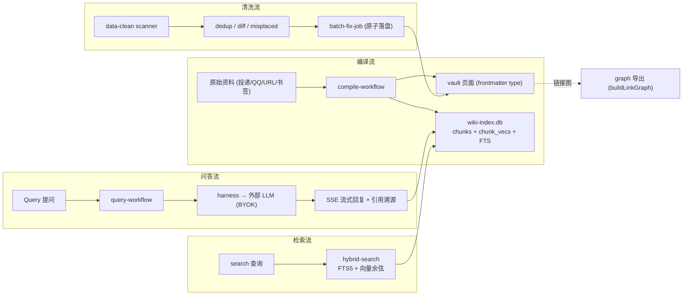

# Karpathy Wiki 系统架构设计文档

> 版本基线：仓库版本 `0.1.202611011`（2026-11-01） | 文档编写：基于工作空间源代码事实梳理，非假设
> 适用范围：`karpathy-wiki` pnpm monorepo（前端 SPA + Fastify 后端 + `@wiki/harness` LLM 运行时）
> 配套文档：《术语表》《概要设计说明书》《数据清洗 SRS/HLD》《知识库问答 AI 对话流设计》

---

## 1. 引言与系统概述

### 1.1 业务背景与核心目标

Karpathy Wiki 是一个**本地优先、AI 增强**的知识库应用：以 Obsidian 风格的 `[[双向链接]]` Markdown 笔记为唯一知识存储，将散落的笔记转化为**结构化、可检索、可对话**的知识体系。它在本地文件系统之上提供检索、问答、知识图谱、资料编译、健康体检、页面质量清洗、内网穿透、MCP 对外暴露等能力，并以**桌面端（单文件可执行程序）或自托管（Linux systemd）**两种形态交付，数据完全本地化、强调隐私优先。

系统定位对齐「Karpathy 风格 AI + Obsidian 知识库」：AI 不是外挂，而是贯穿编译、问答、标签、清洗、播客、多模态的生成链路；同时所有 AI 能力支持 **BYOK（自带密钥）**，密钥不落服务端（前端存浏览器 IndexedDB），契合本地优先的设计哲学。

### 1.2 关键架构事实（来自代码，非假设）

| 事实 | 代码依据 |
|---|---|
| pnpm monorepo，三包：`@karpathy-wiki/web`（前端）、`@karpathy-wiki/api`（后端）、`@wiki/harness`（LLM 运行时） | `karpathy-wiki/package.json`、`pnpm-workspace.yaml`、`wiki-harness/package.json` |
| 前端**不使用 vue-router**，为单视图 SPA，由 `currentView` + hash 驱动 | `frontend/src/App.vue`、`frontend/src/composables/useHashView.ts`、`config/menu.ts` |
| 后端为 Fastify 4，SPA 由 API 在**同一端口（默认 :3000）静态托管** | `api/src/index.ts`、`api/src/spa-static.ts`、`api/src/spa-resolver.ts` |
| 知识库唯一存储是 **Markdown 文件系统（vault）**；语义/向量索引用 **Node 内置 `node:sqlite`**（FTS5 + 向量 BLOB），非 npm 依赖 | `api/src/vault/vault-service.ts`、`api/src/search/sqlite-index.ts`、`api/src/vault/page-scope.ts` |
| 用户/会话/配置为**文件型 + 内存**存储（`users.json` / 内存 Session Map / `config.json`），无独立数据库服务 | `api/src/auth/user-store.ts`、`api/src/auth/session.ts`、`api/src/config.ts` |
| 无 Dockerfile / docker-compose / k8s 清单；交付为桌面 exe 或 Linux 单文件 bundle | 仓库全局检索仅命中 `pnpm-workspace.yaml`、`cleanup-config.yaml`、锁文件 |
| 运行要求 Node ≥ 22.5（内置 `node:sqlite`）；`deploy.sh` 注释写 Node 18+ 存在口径不一致（见 §6.4） | `api/src/search/sqlite-index.ts` 注释、`deploy-linux/deploy.sh` 注释 |

### 1.3 文档边界

本文描述「系统拓扑、模块职责、关键接口、技术栈、部署拓扑」。各业务子领域（问答对话流、数据清洗、RBAC、体检）另有专项设计文档，本文仅做接口级引用，不重复其内部细节。

---

## 2. 总体架构

### 2.1 分层视图

系统以「**浏览器单页应用 ↔ Fastify 聚合服务 ↔ 本地数据层**」为骨架，旁路挂接 LLM 运行时、内网穿透、MCP 对外通道与各类异步工作流。

```mermaid
flowchart TB
    subgraph Client["浏览器 / 移动端"]
        SPA["前端 SPA (Vue3 + Pinia + Element Plus)<br/>无 vue-router，currentView + hash 切换"]
        Mobile["移动端 MobileShell (复用 stores/services)"]
    end

    subgraph Server["Fastify 聚合服务 :3000 (@karpathy-wiki/api)"]
        Gateway["路由网关 + 鉴权中间件 (RBAC)"]
        subgraph Domains["业务路由域"]
            Auth[auth] Compile[compile/SSE] Query[query/SSE]
            Search[search 混合检索] Vault[vault/files/stats]
            DataClean[data-clean/cleanup] Health[health-check]
            Ingest[qq/url/raw/bookmark-ingest] Tunnel[tunnel]
            Mcp["/mcp 对外 JSON-RPC"] Tools[tools/MCP客户端]
            Config[config/ai/users/skill] Media[media/tts/podcast]
        end
        WF["异步工作流 workflows/<br/>compile/query/batch-fix/discover/gaps/media/podcast"]
        Engine["engine/<br/>harness-adapter / byok-override / context-governor"]
        SPAHost["SPA 静态托管 (spa-static + spa-resolver)"]
    end

    subgraph Harness["@wiki/harness (LLM Agent 运行时)"]
        HL["OpenAICompatibleAdapter + runLoopStream<br/>HookManager / checkBudget / LlmPlanner"]
    end

    subgraph Data["本地数据层"]
        VaultFS[("vault/ Markdown 文件系统<br/>唯一知识存储 (chokidar 监听)")]
        SQLite[("wiki-index.db (node:sqlite)<br/>chunks / chunk_vecs / chunks_fts")]
        Files[("config.json / users.json<br/>sessions(内存) / audit.log")]
    end

    subgraph External["外部集成"]
        LLM["外部 LLM (GLM/Ollama/OpenAI 兼容)"]
        WebSearch["联网搜索 (Tavily/Bing)"]
        MediaAPI["Agnes 媒体 API"]
        TunnelProviders["穿透服务 (cpolar/Tailscale/Cloudflare)"]
        ExtMCP["外部 MCP Server (stdio)"]
    end

    SPA -->|REST + SSE| Gateway
    Mobile -->|REST + SSE| Gateway
    Gateway --> Domains
    Domains --> WF
    WF --> Engine
    Engine --> HL
    HL -->|BYOK 每请求覆盖| LLM
    Query --> Search
    Search --> SQLite
    Vault --> VaultFS
    Domains --> VaultFS
    Domains --> SQLite
    Domains --> Files
    Gateway -.旁路.-> Mcp
    Tools -.连.-> ExtMCP
    Tunnel -.暴露公网.-> TunnelProviders
    Media --> MediaAPI
    Gateway --> SPAHost
    SPAHost -.同端口静态.-> SPA
```

### 2.2 层次职责

| 层 | 组成 | 职责 |
|---|---|---|
| 展示层 | 前端 SPA、移动端 MobileShell | 所有用户交互；通过 `services/` 调 API；流式经 SSE；视图状态由 Pinia 管理 |
| API 服务层 | Fastify 路由域 + 鉴权中间件 | 统一鉴权（RBAC）、业务路由分发、SSE 流式、SPA 静态托管、MCP/穿透旁路 |
| 引擎层 | `engine/`、`workflows/`、`harness` 适配 | LLM 调用编排、BYOK 覆盖、上下文治理、异步长任务（编译/问答/批量修复/媒体） |
| 数据层 | vault 文件系统、`node:sqlite` 索引、`config.json`/`users.json` | 知识唯一存储、语义/向量检索索引、配置与用户凭证 |
| 外部集成层 | LLM、联网搜索、媒体 API、穿透服务、外部 MCP | 可插拔能力；密钥经 BYOK/环境变量引用，不硬编码 |

---

## 3. 模块详细设计

### 3.1 前端模块（`@karpathy-wiki/web`）

**架构要点**：Vue3 + Pinia + Element Plus；无 vue-router；`App.vue` 以 `currentView` ref 切换视图，`useHashView` 组合式函数实现 **hash（`#/<view>`）⇄ currentView 双向同步**并带权限守卫，刷新/回退/深链保持。`useIsMobile` 区分桌面/移动端；移动端走独立 `MobileShell`。

**菜单视图（4 组 14 项 + 认证入口）**（`frontend/src/config/menu.ts` 与 `views/`）：

| 分组 | 视图 | 文件 | 职责 |
|---|---|---|---|
| 知识 | 仪表盘 `dashboard` | `views/Dashboard.vue` | 知识库总量与统计总览 |
| 知识 | 知识浏览 `browse` | `views/Browse.vue` | 目录树/看板/日历/章节四模式浏览；草稿与 AI 标签审核 |
| 知识 | 知识问答 `query` | `views/Query.vue` | 对话式问答（流式、引用溯源、澄清） |
| 知识 | 知识图谱 `graph` | `views/Graph.vue` | vis-network 渲染双向链接图（Top-N、搜索定位、显式操作） |
| 生产 | 投递资料 `ingest` | `views/Ingest.vue` | 文件/文件夹上传触发编译 |
| 生产 | 编译进度 `progress` | `views/Progress.vue` | SSE 编译进度展示 |
| 运维 | 体检中心 `health` | `views/Health.vue` | 健康/过期/断链检测与批量修复作业 |
| 运维 | 缓存与日志清理 `cleanup` | `views/Cleanup.vue` | 缓存与日志清理（页级预览开关 + 二次确认） |
| 运维 | 页面质量清洗 `dataclean` | `views/DataClean.vue` | 去重、错位页归位、差异对比、批量动作 |
| 系统 | 配置中心 `config` | `views/Config.vue` | 多子 tab（系统/AI/搜索/工具/隧道等） |
| 系统 | 内网穿透 `tunnel` | `views/Tunnel.vue` | 穿透状态与自检控制 |
| 系统 | 用户管理 `users` | `views/Users.vue` | 管理员 CRUD + 角色 |
| 系统 | 技能管理 `skill` | `views/Skill.vue` | AI 伙伴预设 |
| 系统 | 帮助文档 `help` | `views/Help.vue` | 按菜单的操作用法 |
| 系统 | 关于 `about` | `views/About.vue` | 依赖清单、版本、检查更新 |
| — | 登录 `login` / 注册 `register` | `views/Login.vue`、`views/Register.vue` | 认证入口 |

**关键支撑目录**：`stores/`（auth、compile、conversations、health、model、query、skill、tts、attachments 等 Pinia 状态）、`services/`（apiBase、files、vault、query、auth、config、search 等 API 调用层）、`composables/`（useHashView、usePermission、useIsMobile、useChatAutoScroll、tts/）、`components/`（FloatingChat、MarkdownRenderer、ConversationSidebar、CitationModal、TtsController、ConfigSideNav、HealthIssueList、ModelSelector、移动端 `components/mobile/`）、`utils/`（sse、nav、tunnelDiagnostics、configEffects、dataCleanPresentation、healthList、helpDocSections）、`types.ts` / `types/media.ts`、`styles/themes/`（多主题）。

**核心交互组件**：`FloatingChat`（悬浮问答入口，首屏不自动弹出）、`MarkdownRenderer`（Markdown/Marplit 渲染）、图谱 `vis-network` 封装、`StateBlock`（加载/空/失败三态统一出口）。

### 3.2 后端模块（`@karpathy-wiki/api`，Fastify 4）

**入口**：`api/src/index.ts` 的 `buildApp()` 构建 Fastify 实例并注册全部路由，最后 `setupSpaStatic(app)` 挂载 SPA；`/health` 与 `/wiki/health` 返回 `{ ok, bootId, pid, mode, startedAt }`（`bootId` 用于重启确认）。

**路由域与职责**（`api/src/routes/`）：

| 路由域 | 前缀 | 职责 |
|---|---|---|
| `auth` | `/api/auth/*` | 登录/登出/注册/当前用户/用户管理/审计日志 |
| `compile` | `/api/compile*` | 资料编译（Markdown→结构化知识页），含 SSE 进度 |
| `query` | `/api/query*` | 知识问答（SSE 流式）、归档 `query/archive` |
| `conversations` | `/api/conversations*` | 会话持久化（仅 `conversationsPersist` 开启才注册） |
| `threads` | `/api/threads*` | 线程/会话/记忆管理、上下文压缩 |
| `files` | `/api/files*` | vault 读、目录树、页面列表、媒体服务 |
| `graph` | `/api/graph*` | 链接图节点/边导出 |
| `stats` | `/api/stats*` | 仪表盘统计（与页面口径同源） |
| `schema` | `/api/schema*` | `SCHEMA.md` 读写 |
| `vault` | `/api/vault*` | vault 增删改查、页面写入守卫 |
| `config` | `/api/config*` | 配置读写、受控重启、生效方式标注 |
| `runs` | `/api/runs*` | 运行态/中断任务/步骤追踪（断点续传） |
| `search` | `/api/search*`、`/api/web-search*` | 混合检索（FTS5 + 向量）、联网搜索 |
| `data-clean` | `/api/data-clean*` | 页面质量清洗：扫描/去重/错位归位/差异对比/定时任务 |
| `cleanup` | `/api/cleanup*` | 缓存与日志清理 + 审计日志轮转 |
| `qq-ingest` | `/api/qq-ingest*` | QQ 聊天记录导入抽取 |
| `url-ingest` / `raw-ingest` / `bookmark-ingest` | `/api/url-ingest*` 等 | URL 爬取 / 网页捕获 / 书签导入 |
| `about` | `/api/about*` | 关于信息 + 检查更新（含下载代理） |
| `tools` | `/api/tools*` | 工具（MCP/CLI/场景路由）配置 |
| `mcp-route` | `/mcp`（Streamable HTTP） | 对外暴露知识库能力给外部 AI Agent（JSON-RPC） |
| `skill` | `/api/skill*` | 技能/AI 伙伴预设 |
| `tags` | `/api/tags*` | AI 自动打标签 |
| `discover` / `gaps` | `/api/discover*`、`/api/gaps*` | 双链拓扑相关笔记推荐 / 知识缺口检测 |
| `prompts` | `/api/prompts*` | Prompt IDE（编辑/试运行 `prompts/*.md`） |
| `podcast` / `media` / `tts` | `/api/podcast*`、`/api/media*`、`/api/tts*` | 播客脚本+TTS / 视频图像异步生成 / Edge TTS 朗读 |
| `ai` | `/api/ai*` | AI 服务配置、连接测试、模型列表、共享 AI |
| `tunnel` | `/api/tunnel*` | 内网穿透控制与状态 |
| `uploads` | `/api/uploads*` | 投递原件留存与下载 |
| `health-check` | `/api/health-check*` | 体检/修复工作流 |

**核心子系统目录**（`api/src/` 内）：

- `auth/`：`session.ts`（内存 Session Map）、`user-store.ts`（`users.json` + PBKDF2）、`password.ts`、`rbac.ts`（角色→权限映射）、`permission-cache.ts`、`audit-log.ts`、`auth-rate-limit.ts`。
- `engine/`：`harness-adapter.ts`（对接 `@wiki/harness`）、`byok-override.ts`（每请求配置覆盖）、`context-governor.ts`、`run-state-store.ts`、`thread-memory-store.ts`。
- `vault/`：`vault-service.ts`、`page-scope.ts`（PAGE_DIRS 等口径）、`link-parser.ts`（wikilink 解析唯一实现）、`page-write-guard.ts`。
- `data-clean/`：`quality-scanner.ts`、`dedup-engine.ts`、`diff-engine.ts`、`misplaced-pages.ts`、`ai-analysis-workflow.ts`、`scheduler-manager.ts`。
- `workflows/`：`batch-fix-job.ts`（原子落盘）、`compile-workflow.ts`、`query-workflow.ts`、`discover-workflow.ts`、`gaps-workflow.ts`、`health-check-fix-workflow.ts`、`media-generation-workflow.ts`、`multimodal-output-workflow.ts`、`podcast-workflow.ts`、`pptx-renderer.ts`、`tag-suggest-workflow.ts`、`stream-run-manager.ts`（流式运行管理）。
- `search/`：`sqlite-index.ts`、`indexed-search.ts`、`hybrid-search.ts`。
- `mcp/`：`tools.ts`、`json-rpc.ts`（与 `mcp-route.ts` 配合）。
- `tools/`：`registry.ts`、`mcp-client.ts`（连外部 MCP）、`cli-executor.ts`、`scene-router.ts`、`web-search.ts`。
- `tunnel/`：`tunnel-service.ts`、`tunnel-prerequisites.ts`。
- `qq-ingest/`、`skill/`、`prompts/`、`utils/`（`runtime.ts` 的 `IS_SEA` 打包判定、`spa-resolver.ts`、`sse.ts`、`shutdown.ts` 等）。

**流式与异步**：compile、query、health-check、media 等经 SSE（`reply.raw` / `utils/sse.ts` / `stream-run-manager.ts`）推送进度；长任务支持暂停/续跑/取消（`runs` + `batch-fix-job` 原子落盘）。

### 3.3 LLM 运行时模块（`@wiki/harness`）

轻量 LLM Agent 运行时，定义「Agent = LLM + Harness」。导出 `Harness`、`OpenAICompatibleAdapter`、`FileStateStore`、`runLoop`/`runLoopStream`、`HookManager`、`checkBudget`、`withRetry`、`LlmPlanner` 等。后端经 `engine/harness-adapter.ts` 调用其 `OpenAICompatibleAdapter` + `runLoopStream` 完成流式对话、规划与工具编排，是全部 AI 能力的执行底座。

### 3.4 模块依赖与交互接口

- **前端 → 后端**：`services/apiBase.ts` 统一基址 `API_BASE = import.meta.env.BASE_URL + 'api'`，REST + SSE；无服务端渲染。
- **后端 → harness → 外部 LLM**：`engine/harness-adapter.ts` 调用 `@wiki/harness`，外部 LLM 经 BYOK 每请求覆盖（密钥仅本次内存计算，不落服务端）。
- **后端 → 数据层**：`vault/` 读写文件系统（写受 `page-write-guard` + 白名单约束），`search/` 读写 `wiki-index.db`；`config.json`/`users.json` 由 `config.ts`/`auth/` 读写。
- **旁路**：`mcp-route` 以 `/mcp` 对外暴露检索/读写工具（双 Token 鉴权）；`tools/mcp-client` 作为 MCP 客户端连外部 server；`tunnel` 经穿透服务暴露公网。

---

## 4. 数据架构

### 4.1 存储分层

系统数据由三类本地存储构成，均不依赖外部数据库服务：

1. **vault（Markdown 文件系统）**：知识库**唯一知识存储**。`vault-service.ts` 初始化目录结构并写默认 `SCHEMA.md`，`startFileWatcher()` 用 chokidar 监听外部（如 Obsidian）编辑并失效缓存。
2. **SQLite 语义/向量索引（`wiki-index.db`）**：基于 Node 内置 `node:sqlite`（零依赖、编译期自带 FTS5），承载检索索引。
3. **配置与用户文件**：`config.json`（运行时主配置）、`users.json`（凭证）、`sessions`（内存 Map）、`audit.log`（审计）。

### 4.2 页面口径（单一可信源）

`vault/page-scope.ts` 定义页面目录白名单，是统计、扫描、图谱、清洗共用的口径：

- `PAGE_DIRS = ['entities','concepts','comparisons','queries','qa','solutions']`（页面目录）
- `NON_PAGE_DIRS = ['raw','drafts']`（非页面）
- `NESTED_PAGE_DIRS = ['queries/media']`（允许三层嵌套存生成物）
- `WRITABLE/READABLE/INIT_DIRS` = 页面目录 ∪ raw/drafts；`PAGE_DIR_TO_TYPE` 目录→frontmatter type 映射；`pageDepthError()` 禁止目录内再建子目录（仅两段 `<dir>/<file>.md`）。

`scanVault` 为 `files`/`stats`/`data-clean` 共用的扫描入口，统一复用 `PAGE_DIRS`/`isPageFile`，确保跨视图「页面总数」同源。

### 4.3 数据模型（SQLite 索引）

| 表 / 虚拟表 | 字段 | 用途 |
|---|---|---|
| `chunks` | `id, page_path, chunk_index, content, heading, updated_at` | 文档分块（UNIQUE(page_path, chunk_index)） |
| `chunk_vecs` | `page_path, chunk_index, vec(BLOB), dim, model` | 向量以 Float32Array little-endian BLOB 存储 |
| `chunks_fts` | FTS5 虚拟表（trigram 分词） | 关键词检索（外部内容表 + 触发器同步） |
| `index_status` | `page_path(PK), status, attempts, updated_at` | 索引状态机 |

> embedding 向量由外部 BYOK embedding API 计算得到，本模块不做网络调用；混合检索 = FTS5 关键词 + 向量余弦召回（`hybrid-search.ts`）。

### 4.4 敏感字段与凭证处理

- **API Key**：`config.json` 中明文存储；GET 接口经 `maskApiKey` 脱敏为 `****xxxx`；配置导入/导出经 `maskSecretsInConfig` 递归脱敏（`MIGRATION_SECRET_KEYS` 含 `apiKey/apiKeys/userToken/adminToken/ttsApiKey/cpolarAuthtoken`）。
- **口令**：`auth/password.ts` 用 PBKDF2（默认 10 万迭代 + 随机 salt），不存明文。
- **会话**：`sessionSecretRef`（默认 `WIKI_SESSION_SECRET`）经环境变量引用；会话 token 签名防篡改。
- **QQ 导入 PII**：`config.qq.privacy_patterns`（手机/身份证/邮箱/卡号/QQ 正则）在抽取阶段脱敏。

### 4.5 关键数据流



---

## 5. 技术选型

### 5.1 技术栈清单（版本与角色）

| 层 | 技术 | 版本 | 角色 |
|---|---|---|---|
| 前端框架 | Vue | ^3.4 | 响应式视图 |
| 前端组件库 | Element Plus | ^2.6 | UI 组件 |
| 前端状态 | Pinia | ^2.1 | 全局状态 |
| 前端构建 | Vite | ^5.1 | 开发/构建（含 `vue-tsc` 类型门禁） |
| 前端渲染 | markdown-it / Marpita / mermaid | ^14.1 / ^3.2 / ^11.16 | Markdown/幻灯片/图表渲染 |
| 前端图谱 | vis-network / vis-data | ^10.1 / ^8.0 | 知识图谱可视化 |
| 前端语言/测试 | TypeScript / Vitest | ^5.4 / ^1.6 | 类型与单元/组件测试 |
| 后端框架 | Fastify | ^4.26 | HTTP 服务 + 插件体系 |
| 后端插件 | `@fastify/compress/cors/helmet/multipart/rate-limit/static` | ^7~11 | 压缩/CORS/安全/上传/限流/静态 |
| 后端运行时 | tsx / Node | ^4.7 / ≥22.5 | ESM 直接运行 / 内置 node:sqlite |
| 文件监听 | chokidar | ^5.0 | vault 变更监听 |
| 文档解析 | gray-matter / pdf-parse / adm-zip / pptxgenjs | ^4.0 / 1.1.1 / ^0.6.0 / ^3.12 | frontmatter/PDF/压缩/PPT 解析 |
| HTTP 客户端 | undici | ^8.9 | 全局代理（ProxyAgent） |
| LLM 运行时 | `@wiki/harness`（自研） | — | Agent = LLM + Harness |
| 打包/分发 | `@yao-pkg/pkg` / esbuild / Inno Setup / pnpm | ^6.21 / ^0.28 / — / 11.12 | SEA 单文件 exe / 单文件 bundle / 安装包 / 包管理 |

### 5.2 第三方服务（按配置接入，均支持 BYOK）

| 服务 | 用途 | 默认/配置 |
|---|---|---|
| GLM（bigmodel） | 默认 LLM provider | baseUrl `open.bigmodel.cn/api/paas/v4`，model `glm-4-plus`，`apiKeyRef:'GLM_KEY'` |
| Ollama / OpenAI 兼容 | 可切换 LLM | `llm-presets.json` 归一化模型列表 |
| Tavily / Bing | 联网搜索 | `webSearch`，`apiKeyRef:'TAVILY_API_KEY'` |
| Agnes API | 图像/视频生成 | `media.agnes`，`apiKeyRef:'AGNES_API_KEY'` |
| cpolar / Tailscale / Cloudflare | 内网穿透 | `config.tunnel.provider` 三选一；`pathPrefix:'/wiki/'` 多应用共存 |
| 外部 MCP Server | 工具扩展 | `config.tools.mcpServers`（stdio） |

### 5.3 关键设计模式

- **无 router 的 SPA 视图切换**：`currentView` + `useHashView`（hash 双向同步 + 权限守卫），避免引入 vue-router 的回归面。
- **RBAC 写死映射**：角色 `admin/user/guest` → 权限点映射写于 `rbac.ts`（防运行时篡改），权限缓存 300s。
- **BYOK 每请求覆盖**：`byok-override.applyPerRequestOverride` 仅本次内存计算，密钥不落服务端；前端 BYOK 存 IndexedDB。
- **SSE 流式 + 断点续跑**：长任务（编译/问答/批量修复/媒体）经 `stream-run-manager` + `batch-fix-job` 原子落盘，支持暂停/续跑/取消。
- **同端口 SPA 托管**：API 经 `spa-resolver` 探测 `public_live_<ts>` 快照静态托管，`/wiki/api*` 回环转发保留 SSE/字节流。

---

## 6. 部署与运维架构

> 明确说明：**仓库不含 Dockerfile / docker-compose / k8s 清单**，无容器化交付；交付形态为桌面 exe 或 Linux 单文件 bundle。

### 6.1 开发态

- 前端：`vite`（dev server，默认 `:5173`）。
- 后端：`tsx watch src/index.ts`；Fastify 监听 `config.server.host`（默认 `localhost`）/ `port`（默认 `3000`）。
- `.env` 由 `loadEnvFile()` 加载候选：`%LOCALAPPDATA%/KarpathyWiki/.env`、CWD `.env`、`services/api/.env`。

### 6.2 生产（Windows 桌面 exe）

1. `vite build` → `frontend/dist`。
2. `build-exe.ps1`（esbuild + `@yao-pkg/pkg` + rcedit 注入图标）→ 单文件 exe。
3. Inno Setup（`installer.iss`，AppName=KarpathyWiki，装至 `{autopf}\KarpathyWiki`）生成 `release/installer/KarpathyWiki-Setup-vX.exe`。
4. `publish-wiki.ps1` / `一键发布.bat` 走 GitHub Release（`scripts/publish-release.py` 读 `.env` 的 `GH_TOKEN`，token 不入库）。
5. 运行态：exe 经 `IS_SEA` 判定打包模式，路径落到 `%LOCALAPPDATA%/KarpathyWiki/`；SPA 由 API 同端口 `:3000` 静态托管。

### 6.3 生产（Linux 自托管）

- `deploy-linux/deploy.sh`：esbuild 产出单文件 `api/.build/bundle.cjs`，以 systemd `node bundle.cjs` 运行（后端纯 JS 无原生 binding，可平滑跨平台）。
- 可选 `./deploy.sh pkg` 用 `@yao-pkg/pkg` 打 Linux ELF。
- SPA 静态托管逻辑与桌面态一致。

### 6.4 配置与运维要点

- **运行时配置主体为 `config.json`**（SEA 下 `%LOCALAPPDATA%/KarpathyWiki/config.json`，开发下 `api/config.json`）；`.env` 仅承载 GitHub 发布 token 与可选代理/端口。
- **敏感键名经环境变量引用**：`llm.apiKeyRef='GLM_KEY'`、`webSearch.apiKeyRef='TAVILY_API_KEY'`、`media.agnes.apiKeyRef='AGNES_API_KEY'`、`auth.sessionSecretRef='WIKI_SESSION_SECRET'`；`getEffectiveApiKey` 优先级：config 明文 → `apiKeys[provider]` → `process.env[apiKeyRef]`。
- **全局代理**：读 `HTTPS_PROXY/HTTP_PROXY` 经 undici `ProxyAgent`。
- **重启确认**：`/health` 返回 `bootId`；前端据此判定是否真重启（避免旧进程口径差异，见《验收报告》X6/L1 取证）。
- **优雅停机**：`utils/shutdown.ts` 先停 tunnel → 收尾 SSE → `app.close` → 释放工具/vault/日志。
- **安全**：Helmet/CORS/限流（`@fastify/rate-limit`、登录限流 `auth-rate-limit.ts`）；审计日志 `audit.log` 记录越权与用户管理；CORS 显式放行 `tunnel.publicUrl`。
- **版本口径提示**：`sqlite-index.ts` 注释声明需 Node ≥ 22.5（内置 `node:sqlite`），而 `deploy.sh` 注释写 Node 18+，二者存在口径不一致，实际以 Node ≥ 22.5 为准（潜在部署踩坑点）。

---

## 7. 一致性校验说明

本文所有架构描述均基于当前工作空间源码事实，关键断言已核对以下文件：

- 包结构与版本：`karpathy-wiki/package.json`、`frontend/package.json`、`api/package.json`、`wiki-harness/package.json`、`pnpm-workspace.yaml`。
- 前端视图与切换：`frontend/src/App.vue`、`config/menu.ts`、`composables/useHashView.ts`、`views/*`。
- 后端路由与子系统：`api/src/index.ts`、`routes/*`、`auth/`、`engine/`、`vault/`、`data-clean/`、`workflows/`、`search/`、`mcp/`、`tools/`、`tunnel/`。
- 数据层：`api/src/vault/{vault-service,page-scope,link-parser,page-write-guard}.ts`、`api/src/search/sqlite-index.ts`。
- 部署：`api/src/spa-static.ts`、`spa-resolver.ts`、`utils/runtime.ts`、`scripts/`、`deploy-linux/deploy.sh`、`release/`。

文档未虚构组件：MCP 对外暴露、QQ/URL/书签导入、播客/媒体/TTS、内网穿透、Prompts IDE 等均为代码中实际存在的路由与目录；未包含 Docker/K8s（仓库确无此类配置）。后续若代码演进，应以本章列出的源文件为准复核对应描述。
